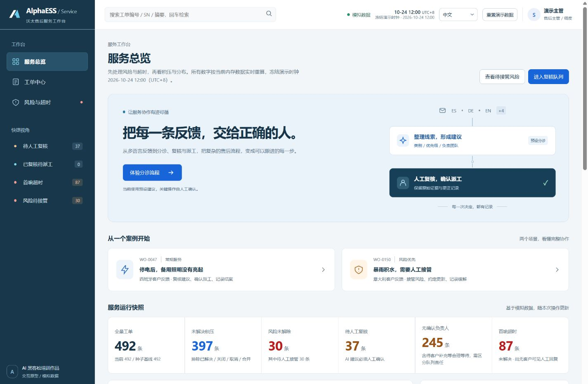
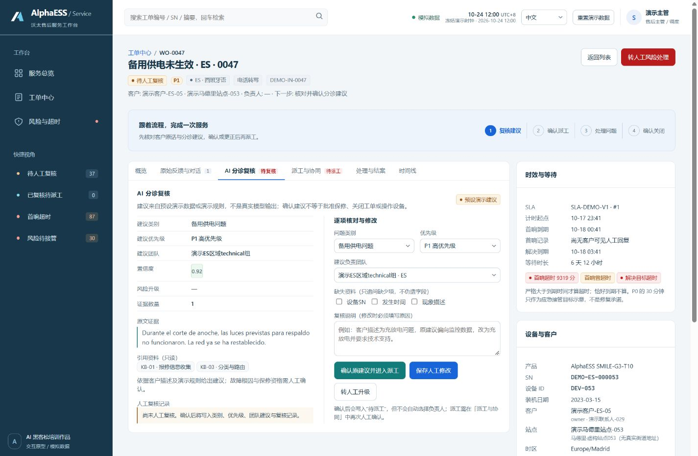
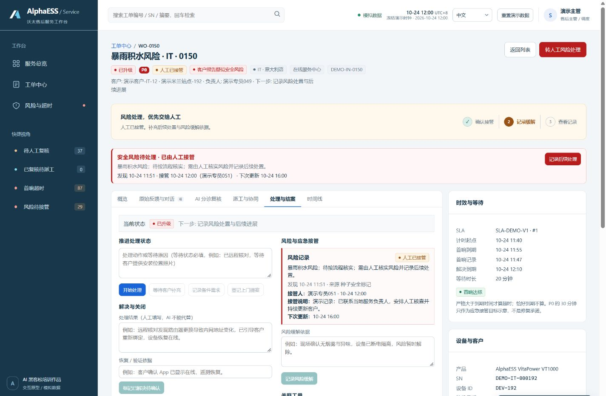
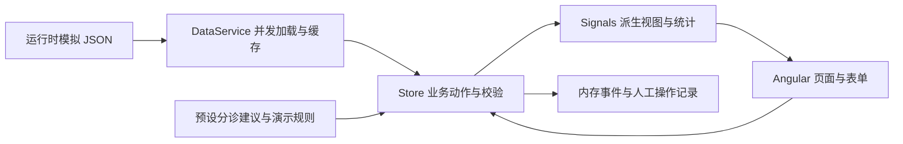

# AlphaESS Service Desk

**沃太售后服务工作台 · AI 分诊与人工协同流程原型**

从多语言客户反馈到建议复核、人工派工、处理结案与风险接管，演示一条有明确责任人、可追溯决策的售后工作流。

公司 AI 黑客松培训作品 · Angular 22 / TypeScript / Signals / Vitest · v0.1.0



[快速运行](#快速运行) · [演示路线](#两条演示路线) · [实现与取舍](#实现与取舍) · [验证](#验证) · [发布说明](docs/DEPLOYMENT.md)

> 当前使用模拟业务数据与预设分诊建议，未调用真实模型。作品用于展示流程设计、AI 工具协作研发与前端工程交付。在线演示地址待仓库和托管方式确定后补充。

## 为什么做这个项目

海外储能售后反馈涉及不同国家、语言与问题类型。一条反馈从接收走到解决，需要整理信息、判断优先级、明确负责人，并持续更新处理进展。

- **先处理什么？** 汇总风险、首响超时、待复核与未解决工单，支持下钻筛选。
- **交给谁？** 复核类别、优先级与团队建议，再结合地区、技能、语言和人员负载人工确认派工。
- **何时算完成？** 区分分派、人工接管、风险缓解、问题解决与客户确认关闭，并保留事件记录。

这些流程是培训项目的设计假设，不代表沃太生产系统的实际实现或不足。

## 快速运行

需要满足项目 `engines` 的 Node.js；`.nvmrc` 选择 Node 24。当前本地验证环境：Node 26.12.0、npm 11.20.0、Python 3.12。

```bash
npm ci
npm start
```

打开 [本地工作台](http://localhost:4200/#/dashboard)。开发服务地址以终端输出为准。

```bash
npm run test:ci        # 21 项应用与业务规则测试
npm run format:check   # Prettier 格式检查（CI 会跑）
npm run validate:data  # 数据结构、关联、时间等校验，需要 Python 3.10+
npm run evaluate       # 规则基线评测，重写 docs/EVALUATION.md
npm run build:pages    # 可部署在网站子目录的静态构建
npm run preview        # http://127.0.0.1:4173/#/dashboard
npm run package        # 生成源码包、静态包与 SHA-256 清单
```

`npm run release` 按顺序执行测试、数据校验、构建和打包。依赖安装后，测试、构建、评测与本地演示都不需要模型 API Key。

## 两条演示路线

### 1. 普通工单：从建议到客户确认

从首页“体验分诊流程”进入 `WO-0047`：西班牙客户报告停电时备用照明未生效。

1. 核对客户原话、证据片段与预设类别、优先级、团队建议。
2. 点击“确认原建议并进入派工”；修改建议时必须填写更正原因。
3. 选择西班牙技术支持团队的可用人员“演示专员013”，确认派工。
4. 在“处理与结案”中开始处理，填写处理结果与验证依据，标记解决。
5. 填写客户确认依据，再关闭工单；在时间线检查操作记录。



### 2. 风险工单：接管与缓解分别确认

从首页“暴雨积水，需要人工接管”进入 `WO-0150`。

1. 核对风险状态：已升级和已回复客户，都不代表已经人工接管。
2. 点击流程指引中的“确认接管”，填写接管说明与下次更新时间，再确认人工接管。
3. 补充风险缓解依据，记录缓解；工单仍需继续服务处理。



操作只保存在浏览器内存，刷新恢复种子状态。顶部“重置演示数据”需要连续两次点击确认，便于反复演示。

## 实现与取舍



| 设计         | 当前实现与理由                                                                           |
| ------------ | ---------------------------------------------------------------------------------------- |
| 人工确认     | 分诊建议不会自动指定负责人；首次派工前需要复核，重要修改需要原因                         |
| 规则校验     | 派工、关闭与风险动作在 Store 中校验，避免仅依赖按钮是否可点击                            |
| 风险状态独立 | 工单状态与接管状态分别记录；未记录缓解的风险工单不能直接解决或关闭                       |
| 派生状态     | 使用 Signals / computed 按 ID 关联工单、客户、设备、建议与事件；主数据本身也是响应式依赖 |
| 可复现演示   | 冻结演示时钟，固定种子数据，一键恢复；避免静态工单随访问日期变化而全部超时               |
| 加载恢复     | 并发加载运行数据，成功后缓存；失败后允许重试，不把失败 Promise 永久缓存                  |
| 静态发布     | 使用 Hash 路由与相对资源基础路径，支持网站子目录和直接分享详情链接                       |
| 数据隔离     | 网页只打包 seed、reference 与必要快照；评估预期、脚本和研究材料保留在源码中              |

模块关系、输入输出和接入模型时的扩展点见 [技术说明](docs/ARCHITECTURE.md)。

## 数据与语言

| 内容        | 规模与边界                                                                      |
| ----------- | ------------------------------------------------------------------------------- |
| 工单        | 492 条模拟工单，包含刻意构造的场景变体                                          |
| 国家 / 语言 | 8 个国家、7 种原有界面语言；不代表实际业务分布                                  |
| 评估材料    | 480 组输入与独立预期、76 个边界用例、24 组多轮对话检查点                        |
| 时钟        | 固定在 2026-10-24 12:00（UTC+8）                                                |
| 国际化      | 界面框架、案例入口与流程引导均覆盖 7 种语言（zh / en / de / nl / es / fr / it） |

客户、设备、人员、工单及业务指标均为虚构。业务内容和原文保留数据中的语言，部分操作说明为中文。详见 [数据说明](data/README.md) 与 [调研和假设](data/research/公开信息调研与业务假设.md)。

现有数据适合功能演示与回归，未验证真实模型泛化表现。预设置信度不代表实际准确率，引用资料是演示知识条目，不是已实现的 RAG 检索。

## 验证

当前版本在本地通过 **21 项应用测试**（5 个测试文件），覆盖：

- 使用实际种子数据的复核、派工、处理、解决与客户确认关闭主线。
- 人工修改必须说明原因、原始建议保留、不可用人员与跨团队成员选择拦截。
- 风险接管与缓解顺序、风险未缓解时的解决拦截、无效更新时间输入。
- 内部备注不计入首响、SLA 恰好到期和超过 1 毫秒的边界。
- 重开保留旧周期、重置恢复种子、加载失败后重试，以及工作台搜索与二次重置确认。
- 作品文案在 7 种界面语言中均有译文，且不回退到英文。

当前没有服务端鉴权、持久化、真实模型、真实通知或设备操作。浏览器检查与数据校验结果见 [验证记录](docs/VERIFICATION.md)。

## 评估

`npm run evaluate` 会在开发集上拟合一个**不调用任何模型的规则基线**，在验证集上做一次检查，再在测试集上只报一次结果，并生成 [评估报告](docs/EVALUATION.md)。当前结果：

| 指标       | 数值                                       |
| ---------- | ------------------------------------------ |
| 类别判定   | 测试集 61.3%（49/80），macro F1 0.727      |
| 泛化衰减   | 开发集 83.1% → 验证集 61.3% → 测试集 41.2% |
| 派生字段   | 优先级 71.2%、团队 66.2%、缺失字段 81.2%   |
| 标注可复现 | 给定类别，其余 4 个字段 480/480 由规则复现 |

三点结论比数字本身更重要，都写在评估报告里：**五个标注字段其实坍缩为一个**，只有类别需要推断；**词面规则跨问题表述就失效**，所以这是下限而不是方案；**20 个 `alarm` 全部判错，其中 12 个被误升级为 `safety`**，这正好是最贵的错误方向。这些数字来自构造样本，不是真实业务准确率。

## 项目来源与 AI 协作

这是公司 AI 黑客松培训中的作业 demo，代码和资料由 AI 编程工具协助完成：

| 工具          | 已确认的工作                                                              |
| ------------- | ------------------------------------------------------------------------- |
| Codex         | 初版 PRD 与模拟数据；本轮视觉打磨、交互指引、业务校验、测试及交付材料整理 |
| Kimi Code CLI | 初版任务拆解与代码实现                                                    |

### AI 协作复盘：哪些缺陷是被发现并修掉的

工具生成的代码能跑，但不会自己变对。以下问题都是先看到现象、再定位、再补验证，而不是靠"再生成一次"：

| 现象                  | 实际原因                                                         | 处理                                                        |
| --------------------- | ---------------------------------------------------------------- | ----------------------------------------------------------- |
| 首页分布条全是空白行  | 填充条是行内元素，宽度按百分比不生效，实际宽高为 0               | 改为块级元素，截图留证                                      |
| 网络失败后重试无效    | 失败 Promise 被长期缓存，重试拿到的是同一个拒绝                  | 失败后清除进行中的 Promise，并补重试测试                    |
| `npm test` 一直是红的 | 脚手架默认断言 `Hello, servicedesk`，与实际页面无关              | 换成基于真实种子数据的业务规则测试                          |
| 切到德语后首页变英文  | 新增作品文案只有中英两套，其余语言静默回退                       | 补齐 5 门语言，并加一条禁止回退的测试                       |
| 评估集闲置            | `data/evaluation/` 有 480 组输入与独立预期，但没有任何脚本消费它 | 写出规则基线脚本，把结论和失败案例放进 `docs/EVALUATION.md` |

这一版本的价值是可运行、可解释和可验证的工作流原型。真实模型接入、受控工具调用和模型评估列为后续工作，不作为已实现能力描述。

## 目录与发布

```text
src/app/core/       数据契约、加载、状态、业务动作、国际化与测试
src/app/pages/      服务总览、工单列表、详情、风险中心
src/app/shared/     徽标、空态、负载条、状态驱动的流程指引
data/              模拟数据、独立评估材料、校验脚本和研究说明
docs/              架构、验证、评估报告、部署、截图与原始 PRD
scripts/           规则基线评测、本地生产预览、源码与静态版本打包
.github/workflows/ 自动验证（格式、测试、数据校验、评测、构建）；手动触发的 Pages 部署
```

GitHub 账号、仓库名称和公开范围尚未确定，本轮只准备发布配置和本地包：远程仓库尚未创建，`Verify demo` 工作流与 Pages 都还没有在真实远程跑过，因此不能称为"已发布"。使用说明见 [发布与部署](docs/DEPLOYMENT.md)。原始 README 留存在 [初版说明](docs/archive/README-initial.md)，以本页为当前版本的入口。

## 许可

源代码采用 [MIT 许可证](LICENSE)。模拟数据与文档可用于阅读、复现和教学演示；沃太 / AlphaESS 名称与商标不在授权范围内。完整边界见 [NOTICE](NOTICE.md)。
