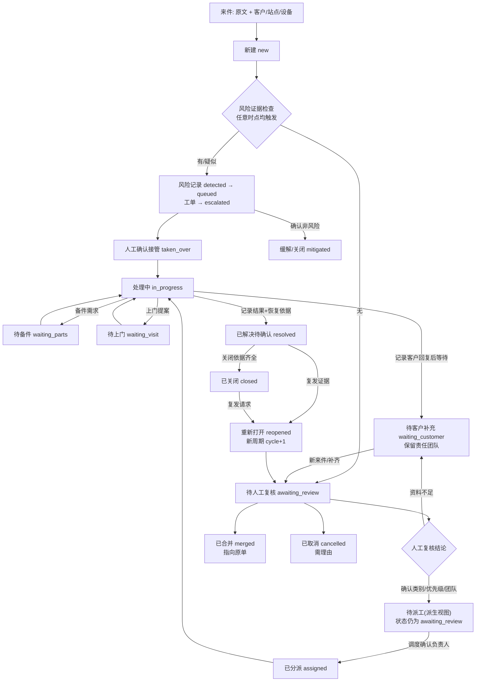

<!--
文档名称：沃太售后服务工作台总设计PRD（V2.0）
文档编号：WT-ASD-WB-PRD-002
版本：V2.0
日期：2026-10-24（Asia/Shanghai）
文档状态：Demo交付评审稿；用于首期可交互演示的范围界定、信息架构与验收，不代表企业已审批上线。
文档层级：总设计。上承两份V1基线文档，向下唯一约束《沃太售后服务工作台模块拆解与页面规格-V2.0.md》。
基线文档（保留，不覆盖）：
  1. docs/prd/沃太能源售后工单智能分诊与流转系统PRD.md（WT-ASD-SYS-PRD-001，V1.0）
  2. docs/prd/沃太能源售后工单智能分诊与流转模块PRD.md（WT-ASD-MOD-PRD-001，V1.0）
数据依据：data/ 模拟数据包1.0.0；冻结时钟 2026-10-24T04:00:00Z；492条工单、480组分诊案例、76个边界案例、24组连续对话。
范围：售后服务工作台的业务闭环、状态机、页面收敛、交互一致性、风险与时效规则、指标口径与首期验收。
不包含：前端代码、后端实现、数据库设计、真实模型接入、真实通知发送、真实鉴权、新的数据集。
人机边界：Agent只做整理、建议、草稿与提示；派工、改派、合并、接管、解决、关闭由人工确认。
优先级命名：Must/Next/Later为功能建设顺序；P0—P3为工单严重度，另设“待判定”表示优先级尚未确认，二者不混用。
相对V1.0的主要调整：
  A1 页面收敛：12个独立页面收敛为4个主页面（P01服务总览、P02工单中心、P03工单详情、P04风险与超时），另有详情页签与右侧信息栏；新建工单、知识库、主数据、客户视图降为Next。
  A2 风险旁路：任意未终态工单可直接升级；新增独立“风险记录”（detected→queued→taken_over→mitigated/closed）；无接管记录不得显示已接管；缺SN不阻塞入队。
  A3 动作统一：所有操作按“动作→校验→写状态/写事件/写消息→列表/详情/时间线/看板同步重算”执行；禁止只弹提示不落库的假交互。
  A4 复核与派工分离：人工确认复核只产生“待派工”派生视图，不写负责人；调度确认后才写负责人与分派记录。
  A5 优先级口径修正：28条priority=null的工单在V1看板中被并入P1—P3；V2独立显示“待判定”，不混入P0—P3统计。
  A6 状态流转补齐：新增resolved→reopened、in_progress→waiting_customer/escalated；resolved→closed需关闭依据；waiting_*保留负责人。
  A7 时效口径：冻结演示时钟；严格大于到期时间才判超时；首响、接管、修复为三件事；P0不参与普通解决目标达成率。
  A8 数据复用：直接读取data/seed与data/reference，不重造数据集；纯前端内存态，刷新恢复种子，提供“重置演示数据”。
  A9 视觉与信息：浅色极简、瑞士网格、蓝+青绿主色；红/橙/绿语义状态始终带文字；禁止emoji；数据密集型表格。
使用说明：先读本文确定范围与规则，再按模块拆解文档做页面与动作实现，最后按两边验收编号联合验证。
维护要求：状态名、动作名、事件名、指标公式与字段名变更时，两份V2文档同步修改；V1文档作为基线保留，不做追溯改写。
-->

# 沃太售后服务工作台总设计 PRD（V2.0）

## 文档信息与阅读指引

| 项目 | 内容 |
| --- | --- |
| 文档编号 | WT-ASD-WB-PRD-002 |
| 版本与日期 | V2.0 · 2026-10-24 |
| 产品名称 | 沃太售后服务工作台（课程Demo名称，不是沃太已发布产品） |
| 首期形态 | 4个主页面 + 详情页签与右侧信息栏的纯前端演示（Angular），操作仅存在于内存 |
| 数据版本 | data/ 模拟数据包 1.0.0，冻结时钟 2026-10-24T04:00:00Z |
| 上游基线 | 系统PRD V1.0（WT-ASD-SYS-PRD-001）、模块PRD V1.0（WT-ASD-MOD-PRD-001） |
| 下游文档 | 《沃太售后服务工作台模块拆解与页面规格-V2.0.md》 |

本文与两份V1文档的关系：

- **不变的部分直接引用，不重复展开。** 14类问题类别、13种工单状态、P0—P3定义、业务规则BR01—BR14、模块编号M01—M08、GAP01—GAP08差异清单、人机协作边界、数据真实性与虚构边界，全部沿用V1。本文只在状态机、页面结构、风险记录、指标口径四处给出增量。
- **V1是基线，V2是可交付的收敛版本。** V1的12个页面（P01—P12）是完整业务域的页面清单；V2不否定它，只是把首期Demo收敛为4个主页面，把其余页面排入Next。
- **V2中新增或改写的编号**：页面用P01—P04（含义与V1不同，见第5章映射）；状态跳转用TR01—TR12；风险记录状态用RS01—RS05；V2验收用AC-V2-01—AC-V2-10；其余沿用V1编号。
- **冲突处理**：本文与V1正文在页面编号、状态跳转、优先级口径三处存在差异，以本文为准；其余以V1为准。

阅读路径：产品/业务评审读第1—5章；前端开发读第5、6、11章并转到模块拆解文档；测试读第9、10、12章。

## 1. 产品定位与要解决的问题

**定位**：帮助客服把多语言报修整理清楚、交给合适的人，并持续跟踪到处理完成的售后工作台。

首期Demo要证明的不是“AI能自动处理工单”，而是一个可复核、可追溯、状态一致的服务闭环：一条来件进入后，原文与设备可核对，判断可被人工确认或更正，负责人经确认后写入，风险可以在任何时点旁路升级并被真实接管，超时能被发现，关单有依据，且看板数字随操作实时重算。

要解决的四个业务问题（对应V1的H01—H05，此处只保留与首期范围直接相关的部分）：

| 问题 | 表现 | V2的应对 |
| --- | --- | --- |
| 信息不全且反复问询 | 多语言来件缺少SN、发生时间、可观察现象 | 原文与中文摘要并列；缺失项按类别必要字段生成；已提供字段不重复追问 |
| 判断依赖个人经验 | 类别、优先级、团队选择缺少依据 | 建议带证据片段、依据说明、置信度与知识条目；人工可逐项更正并留痕 |
| 无人负责或责任不清 | 等待状态没有明确跟进人 | 复核与派工分离；确认派工才写负责人；等待类状态保留负责人 |
| 风险与超时发现滞后 | 危险证据被普通队列掩盖 | 风险独立记录与旁路升级，四视图监控首响与解决目标 |

明确不解决的：不自动诊断根因、不操作设备、不判保赔付、不真实发送通知、不替代值班人员做安全决策。

## 2. 用户与责任边界

| 用户 | 在系统中做什么 | 关键限制 |
| --- | --- | --- |
| 一线客服 | 受理、补问、复核建议、记录客户回复、发起风险升级 | 不能批准保修赔付；不能跳过复核直接关闭 |
| 区域技术支持 | 接手处理、记录处理动作、申请备件或上门、标记已解决 | 诊断结论需自身资质；不得给出带电/拆机操作指引 |
| 服务调度 | 确认派工、改派、核对技能/语言/容量 | 只能派给匹配团队与可用人员；不可用必须写明原因 |
| 售后主管/应急负责人 | 确认风险接管、记录缓解、审核合并与关闭 | 接管需独立记录；不得用普通分派冒充接管 |
| 客户/安装商 | 提供补充信息、确认恢复 | 首期不出独立客户页面，客户视角降为Next；内部备注不可见 |
| Agent | 整理原文、提取字段、建议类别/优先级/团队、列缺失项、起草回复、提示风险 | 只建议不执行；不写负责人、不关单、不判保、不控制设备 |

责任边界三条硬约束：

1. **状态与负责人只能由确认动作写入。** 建议值、候选值、草稿都不得显示为已确认结果。
2. **风险提示与入队可自动发生，接管必须由人确认。** 没有接管人、接管时间与接管说明的记录，界面一律显示“无接管记录”。
3. **首期角色切换只是演示开关。** 前端隐藏按钮不等于权限控制；真实上线须由服务端校验（沿用V1第3章与BR14）。

## 3. 优化后的业务闭环与状态机

### 3.1 主流程

风险路径（实线从 `R` 出发）与主链路并行，不占用复核队列，也不因缺SN、缺附件、AI不可用而延后。

### 3.2 状态表（13种，含义沿用V1）

| 状态 | 进入条件 | 责任 | V2允许动作 | 下一状态 |
| --- | --- | --- | --- | --- |
| new 新建 | 来件已受理 | 受理客服 | 查看原文、发起分诊复核、直接升级风险、合并、取消 | awaiting_review / escalated / merged / cancelled |
| awaiting_review 待人工复核 | 存在待确认建议或信息不明确 | 复核客服 | 确认复核、修改复核、追问并等待、升级风险、派工、合并、取消 | 复核完成进入待派工视图（状态不变）/ waiting_customer / assigned / escalated |
| waiting_customer 待客户补充 | 已记录追问内容 | 原负责团队（保留） | 记录客户回复、补资料、升级风险、重新复核 | awaiting_review / escalated |
| assigned 已分派 | 已确认团队与人员 | 负责人 | 开始处理、改派、发起风险升级、合并、记录备注/回复 | in_progress / escalated / merged / assigned（改派后仍为 assigned） |
| in_progress 处理中 | 负责人已接手 | 负责人 | 记录处理、记录客户回复、等待客户、申请备件、提出上门、升级风险、合并、标记解决 | waiting_customer / waiting_parts / waiting_visit / escalated / merged / resolved |
| waiting_parts 待备件 | 已记录备件需求与等待原因 | 负责人（保留） | 更新备件进展、恢复处理、升级风险 | in_progress / escalated |
| waiting_visit 待上门 | 已记录上门提案（客户未确认也算） | 负责人（保留） | 更新提案、恢复处理、升级风险 | in_progress / escalated |
| escalated 已升级 | 风险记录已入队，或人工判定需上级处理 | 应急负责人/主管 | 确认接管、记录缓解、恢复处理、标记解决 | in_progress（接管后）/ resolved / escalated |
| resolved 已解决待确认 | 已记录结果与恢复依据 | 负责人+有结案权限者 | 确认关闭（需依据）、重开 | closed / reopened |
| reopened 重新打开 | 出现复发证据，开启新周期 | 复核客服 | 复核、派工、升级风险、处理 | awaiting_review / assigned / in_progress / escalated |
| closed 已关闭 | 结果、依据与操作者齐全 | 主管/有权限客服 | 查看历史、请求重开 | reopened |
| cancelled 已取消 | 经授权记录取消理由 | 授权人员 | 查看历史 | 终态 |
| merged 已合并 | 人工确认原单 | 主管/有权限客服 | 跳转原单 | 终态 |

### 3.3 V2补齐的状态跳转（TR01—TR12）

V1的GAP02/GAP04指出种子工作流缺少的边。V2把补齐结果固定为下表，前端只允许这些跳转，其余组合必须给出“不允许该操作”的明确原因。

| 编号 | 跳转 | 触发动作 | 说明 |
| --- | --- | --- | --- |
| TR01 | new → escalated | 升级风险 | 风险旁路，不要求先复核 |
| TR02 | awaiting_review → escalated | 升级风险 | 复核中发现新证据 |
| TR03 | waiting_customer → escalated | 升级风险 | 客户补充中出现危险描述 |
| TR04 | in_progress → escalated | 升级风险 | 处理中新风险 |
| TR05 | waiting_parts / waiting_visit → escalated | 升级风险 | 种子已存在该边 |
| TR06 | reopened → escalated | 升级风险 | 复发后新风险 |
| TR07 | in_progress → waiting_customer | 等待客户 | 需记录等待原因与下一次更新预期 |
| TR08 | resolved → reopened | 重开 | 种子缺失该边，V2补齐；旧周期保留 |
| TR09 | resolved → closed | 确认关闭 | 必须填写关闭依据并选择依据类型 |
| TR10 | escalated → in_progress | 确认接管并恢复处理 | 必须在同一事务内绑定风险记录接管 |
| TR11 | waiting_parts / waiting_visit → in_progress | 恢复处理 | 负责人不清空 |
| TR12 | awaiting_review → assigned | 确认派工 | 复核未完成时禁止，需先确认复核 |

“待派工”不是第14种状态：它是 `review.status ∈ {accepted, corrected}` 且 `assigned_agent_id = null` 的派生视图，用于把“判断已定、人未定”的工单从复核队列里分出来。这样既不新增状态，也让派工队列有明确入口。

## 4. 关键设计决策与取舍

| 编号 | 决策 | 取舍理由 | 代价与应对 |
| --- | --- | --- | --- |
| D1 | 首期只建4个主页面（P01—P04） | 同一业务动作不建两套规则；演示优先保证业务闭环与状态一致性，而非页面数量 | 队列视角减少；用P02的保存筛选 + P04的四视图补偿 |
| D2 | 复核、派工、沟通、结案合并为P03页签 | 操作对象是同一张工单，拆页面会造成状态不同步与重复校验 | 页签必须共享同一份工单状态快照（见6.1） |
| D3 | 风险独立记录，不寄生在工单状态 | 工单状态只有一个，但风险有生命周期（发现→入队→接管→缓解）；没有记录就无法证明接管 | 需新增 riskRecords 实体与4个事件类型 |
| D4 | 风险允许从任意未终态直接升级 | 安全优先于流程完整性；等复核会让危险信息排在队列后面 | 可能出现“复核未完成即升级”的工单，需在详情显示两条并行进度 |
| D5 | 复核与派工分离但连续 | 判断归客服、授权归调度；混在一个按钮里会把“建议团队”写成“已派工” | 多一次点击；用“确认复核后自动进入待派工视图”降低摩擦 |
| D6 | 冻结演示时钟 | 静态种子数据一旦用本机时间计算，全部工单会瞬间超时，指标失去意义 | 页面必须显著标注演示时钟与UTC基准 |
| D7 | priority=null 单列“待判定” | null是未知，不能当P2；混入统计会让看板口径不可解释 | P0—P3合计464，待判定28，两者分开显示并在列表用文字说明 |
| D8 | 操作只写内存，刷新恢复种子 | 首期无后端；避免半持久状态造成“演示数据被改坏”的误导 | 提供重置入口与“数据已修改”提示 |
| D9 | 不重造数据集 | 数据包已校验；重造会引入未经验证的数字与口径漂移 | 仅新增运行时实体（风险记录、复核记录、动作日志） |
| D10 | 视觉极简、状态必须带文字 | B端数据密集场景下颜色不能作为唯一编码 | 徽标=色块+文字；禁止emoji |

被明确放弃的方案：用“已接管”徽标代替接管记录；用弹窗提示代替状态写入；用页面级独立队列实现同一动作的第二套规则；用前端当前时间计算超时。

## 5. 信息架构与页面地图

顶部一级导航4项，其余能力通过页签、右侧信息栏、下钻承载。

| 页面 | 承载模块 | 核心动作 | 下钻关系 | 首期 |
| --- | --- | --- | --- | --- |
| P01 服务总览 | M08 + M05摘要 | 读指标、点卡片带条件进入P02/P04 | 卡片 → P02（带 status/priority/overdue/risk 参数） | Must |
| P02 工单中心 | M01 | 搜索、筛选、排序、分页、批量查看、重置演示数据 | 行 → P03（ticketId + 返回参数） | Must |
| P03 工单详情 | M02 / M03 / M04 / M06 | 复核确认与更正、派工与改派、内部备注与客户回复、开始处理与等待、备件/上门、标记解决、确认关闭、重开、合并、升级风险 | 页签内跳转；关联单 → P03；风险 → P04 | Must |
| P04 风险与超时 | M05 | 四视图切换、确认接管、记录缓解、确认非风险、跳转工单 | 行 → P03（tab=risk 或 time） | Must |
| 新建/导入工单 | M01 | 手工受理、导入模拟来件 | — | Next（首期用P02的“演示样本”入口打开既有工单） |
| 知识库与规则 | M07 | 查知识、查规则、查路由依据 | — | Next（首期以P03复核页签的只读依据区呈现） |
| 主数据与权限 | M07 | 查客户/站点/设备/团队/人员 | — | Next（首期以右侧信息栏呈现团队与人员快照） |
| 客户视图（我的反馈） | M01 | 客户补资料、查进度、确认恢复 | — | Next |
| 服务分析 | M08 | 国家/类别/团队分布与趋势 | — | Later |

页面与V1的对应：P02 ≈ V1 P02；P03 ≈ V1 P04 + P05 + P06 + P08（操作面板）；P04 ≈ V1 P07；P01 ≈ V1 P01 + P10摘要。V1 P03/P09/P11/P12与P10的独立视图不再单列页面。

详情页签与右侧信息栏：

| 页签 | 承载 | 主要动作 |
| --- | --- | --- |
| 概览 | 结论区：谁、什么设备、什么问题、现在谁处理、下一步 | 快捷动作入口 |
| 原始反馈与对话 | 原文、译文、消息流、附件 | 记录内部备注/客户回复、追加附件 |
| AI分诊复核 | 建议、证据、缺失项、置信度、历史版本 | 确认复核、修改复核、追问草稿 |
| 派工与协同 | 候选团队/人员、校验结果、备件与上门 | 确认派工、改派、备件申请、上门提案 |
| 处理与结案 | 处理记录、结果、关闭依据、重开、合并 | 开始处理、等待、标记解决、确认关闭、重开、合并 |
| 时间线 | 状态事件与动作日志（只追加） | 查看、复制引用 |

## 6. 统一交互与状态一致性规则

### 6.1 动作原子性

每个业务动作按固定五步执行，任一步失败则整体回滚并保留用户输入：

1. **校验**：前置状态、必填字段、权限、版本（`ticket.updated_at` 与页面快照一致）。
2. **写状态**：更新 ticket 的状态、负责人、优先级、类别、缺失项等目标字段。
3. **写事件**：向 events 追加一条含 `actor_type/actor_id/reason/correlation_id` 的记录。
4. **写消息或记录**：客户回复写 messages（visibility=customer），内部备注写 messages（internal），派工写 assignments，风险写 riskRecords。
5. **重算**：派生字段（isOverdue、isUnresolved、nextAction、riskStatus）与看板计数按当前内存数据重算，列表、详情、时间线、P01、P04 同步刷新。

禁止行为：只 toast 提示不落库；只改前端展示不改 events；用弹窗“确认”代替接管记录；把一个按钮同时完成复核与派工。

### 6.2 幂等与并发

- 同一动作在 `2s` 内重复触发视为重复提交，只执行一次，第二次提示“该操作已完成”。
- 每个动作带 `correlation_id`，事件与派生记录共享同一 correlation，便于时间线聚合。
- 页面快照过期（他人已改）时提示“数据已更新，请重新核对”，禁止静默覆盖；不提供强制覆盖按钮。

### 6.3 失败与空态

- 校验失败：字段级红字+文字说明，输入保留，不改变任何状态。
- 数据读取失败：显示“读取失败/重试”，不用 0 或空列表冒充结果。
- AI不可用：复核页签显示“预设演示建议”与手工填写入口，风险升级入口始终可用。
- 空列表：说明当前筛选无可匹配工单，提供“清除筛选”与“查看全部”。

### 6.4 内外部内容分离

- `visibility=customer` 的消息才计入首响；`internal` 永不进入客户可见范围，也不计入首响。
- 客户回复必须经人工确认动作写入；草稿状态显示“未提交”，不得显示“客户已收到”。
- 首期不真实发送邮件/短信/站内推送，界面注明“仅本地记录”。

### 6.5 时间线与筛选保留

- 时间线只追加，不覆盖、不重排已发生事件；未来上门提案单独归入“提案”，不与已发生历史混排。
- 从 P01/P04 下钻到 P02/P03 后返回，筛选条件、排序、页码、展开行全部保留（写入 URL query）。

### 6.6 双编码与叙述规范

- 状态、优先级、风险、超时一律“颜色+文字”双编码，颜色仅作强化。
- 数值口径必须可解释：任何统计卡片带口径说明的悬浮/展开文本，注明排除状态与冻结时钟。
- 不使用emoji；不使用“智能”“一键”“秒级”等营销措辞。

## 7. 分诊建议模型

### 7.1 建议对象字段

| 字段 | 说明 | 展示要求 |
| --- | --- | --- |
| proposal.category_id | 14类之一 | 显示中文类名与英文ID |
| proposal.priority | P0—P3 | 与“待判定”区分：无建议时显示待判定 |
| proposal.team_id | 建议团队（非已分派） | 标注“建议”，与负责人栏分离 |
| proposal.confidence | 0—1 | 显示为“建议置信度”，不表述为正确率 |
| proposal.missing_fields | 缺失字段清单 | 按类别必要字段生成 |
| proposal.escalation_required | 是否建议升级 | 为真时页面顶部出现风险条 |
| proposal.evidence_spans | 原文片段 | 需可定位到原语言消息 |
| proposal.rationale_zh | 中文依据 | 与知识条目KB编号并列 |
| proposal.knowledge_ids | 引用知识 | 在复核页签内查看只读依据 |
| review.status | pending / accepted / corrected | 决定工单是否进入待派工视图 |
| review.final_category_id / final_team_id | 人工最终值 | 与建议值并列展示差异 |

### 7.2 复核规则

- 置信度 `< 0.8` 标为“需重点核对”，并在复核页签置顶提示；置信度 ≥0.8 仍需人工确认（沿用V1第8.2章）。
- 人工可只改其中一项（如只改类别不改优先级），系统按修改后的类别重新校验路由，并提示候选团队变化。
- 更正留痕：保留原建议、改后值、操作者、时间、原因（原因必填，下拉+自由文本）。
- 每次重新分诊生成新版本，旧版本不可删；详情页签显示“建议 v1 / v2”差异。
- 预设演示建议必须显示“预设演示建议（数据包 ai_suggestions.json，非实时模型输出）”，与真实生成严格区分。

### 7.3 数据现状与使用边界

种子共 452 条建议：`accepted 412`、`pending 37`、`corrected 3`；置信度低于0.8的 67 条；建议升级 50 条；带缺失项的 200 条。37 条 pending 与 37 条 `awaiting_review` 工单一一对应，构成首期复核队列的初始规模。这些数字是样本覆盖设计，不是模型准确率。

## 8. 派工与资源协同规则

### 8.1 校验顺序

沿用 `routing_rules.json` 的优先级：安全覆盖 → 信息充分性 → 类别技能 → 设备所在国 → 语言 → 可用性 → 容量。

| 校验项 | 通过条件 | 不通过时的表现 |
| --- | --- | --- |
| 安全覆盖 | 风险工单优先归 `TEAM-GLOBAL-SAFETY` | 显示“风险工单建议全局安全组”，但不阻止升级 |
| 信息充分性 | 复核已确认（review 非 pending） | 禁止派工按钮并说明“需先完成复核” |
| 类别技能 | 团队 skills 含类别 required_skill | 候选列表中标记“技能不匹配”并置灰 |
| 设备所在国 | 团队 country_codes 含站点国，或为 `*` 全球组 | 标记“国家不覆盖” |
| 语言 | 人员 languages 含客户语言或可提供语言协助 | 标记“需语言协助”，不自动改国别 |
| 可用性 | agent.availability = online | 标记“离线/休假/忙碌” |
| 容量 | current_open_ticket_count < capacity | 标记“容量已满”，进入调度队列 |

### 8.2 确认与改派

- 派工必须由人在候选列表中点选具体人员并确认；确认前显示的候选、负载、不匹配原因都不是分派结果。
- 确认成功后原子写入：`assigned_team_id`、`assigned_agent_id`、assignments 记录（含 `approved_by`）、事件 `assigned`、状态 → assigned。
- 改派：填写新负责人与原因，保留原负责人历史；新接收方未确认时原责任不丢失，界面显示“待接收”。
- 无可用人员：不伪造派工，工单停留在待派工视图，并在 P02 显示“无可用人员（原因）”。
- 首期人员数据：27个团队、54名专员（在线27、忙碌9、离线9、休假9），容量与在办数来自 agents 快照，负载按当前工单重算。

## 9. 风险与时效规则

### 9.1 风险记录生命周期（RS01—RS05）

| 状态 | 含义 | 写入条件 | 界面表现 |
| --- | --- | --- | --- |
| RS01 detected | 已发现风险证据 | 规则/建议/人工在任意未终态工单上发现 | 工单顶部风险条 + P04“当前风险” |
| RS02 queued | 已进入人工接管队列 | 记录入队团队与入队时间 | P04“待人工接管”列出 |
| RS03 taken_over | 人工已接管 | 记录接管人、接管时间、接管说明、下一次更新预期 | 才可显示“已接管” |
| RS04 mitigated | 已缓解或确认非风险 | 记录缓解依据与操作者 | 风险条转为“已缓解”，工单可回处理中 |
| RS05 closed | 风险关闭 | 问题解决且接管人确认 | 归档，不删除 |

字段：`riskRecordId`、`ticketId`、`status`、`detectedAt`、`detectedBy`（rule/agent/human）、`riskType`（safety/thermal/electrical/water/other）、`evidenceMessageId`、`severityHint`、`queueTeamId`、`queuedAt`、`takenOverBy`、`takenOverAt`、`takeoverNote`、`nextUpdateDueAt`、`mitigatedAt`、`mitigateReason`、`closedAt`。

硬规则：

- 缺SN、缺附件、缺发生时间都不阻塞 detected→queued。
- 种子30条 `reported_risk` 工单（WO-0131—WO-0150、WO-0251—WO-0260）当前均为 escalated，但数据包没有接管记录 → 全部显示“无接管记录 / 待人工接管”，**不得**用 escalated 状态或分派记录冒充接管。
- 风险不能因普通复核结论、客户否认、超时而无记录地撤销；降级必须走 mitigated 并写明依据。

### 9.2 四个业务视图（P04）

| 视图 | 定义 | 种子基线 |
| --- | --- | --- |
| 当前风险 | 存在 status ∈ {detected, queued, taken_over} 风险记录的工单；种子按 safety_flag=reported_risk 派生 | 30 |
| 待人工接管 | 风险记录为 detected/queued，或 escalated 但无接管记录 | 30 |
| 待首响超时 | 未解决、未排除、首响为空、且 asOf > first_response_due_at | 87 |
| 解决目标超时 | 未解决、未排除、且 asOf > resolution_due_at | 369（含P0 29，普通口径340） |

### 9.3 SLA定义与判定

- 计时基准：`clock_start_at`（当前周期起点，重开取新周期起点），24×7 连续UTC，不暂停（`pause_statuses: []`）。
- 目标分钟数（演示值，非服务承诺）：P0 15/30、P1 60/240、P2 240/1440、P3 1440/4320（首响/解决）。
- 判定：**严格大于**到期时间才算超时，恰好等于不算。示例：P2 工单 `first_response_due_at = 2026-10-24T04:00:00Z` 且首响为空 → 未超时；`asOf = 2026-10-24T04:00:01Z` → 超时。
- 三件事必须分开：首响（第一条客户可见人工消息）、接管（风险记录 taken_over）、修复（工单 resolved）。任何一处缺失即显示缺失，不做推断。
- P0特例：不参与普通解决目标达成率；30分钟仅作应急接管目标示意；P0仍纳入首响监控与风险积压。
- 取消、合并、`sla.excluded=true` 排除当前周期统计；重开保留旧周期结果，旧超时不因新周期而消失。
- 站内提醒：种子456条（首响超时87 + 解决目标超时369），去重键 `ticketId:cycle:type`；同一条件重复计算不新增提醒。

## 10. 数据与指标口径

### 10.1 复用文件与数量

| 用途 | 文件 | 数量 |
| --- | --- | --- |
| 工单主表 | data/seed/tickets.json | 492 |
| 消息 / 事件 | seed/messages.json · seed/events.json | 1316（客户可见921 / 内部395）· 1774（system 956 / human 818） |
| 分派 / 备件 / 上门 / 重复 / RMA | seed/assignments · part_requests · visits · duplicate_candidates · rma_requests | 208 · 13 · 26 · 12 · 12 |
| 建议 / 附件 / 提醒 / 评价 / 遥测 | seed/ai_suggestions · attachments · notifications · csat · telemetry | 452 · 150 · 456 · 28 · 93 |
| 主数据 | reference/customers · sites · devices · products | 96 · 192 · 192 · 12 |
| 服务组织 | reference/teams · agents · spares | 27 · 54 · 5 |
| 规则 | reference/categories · routing_rules · workflow · sla_policies · roles · knowledge_base | 14 · 1 · 1 · 1 · 4 · 10 |

### 10.2 状态与优先级基线（冻结时钟）

状态：new 28、awaiting_review 37、waiting_customer 180、assigned 27、in_progress 27、waiting_parts 13、waiting_visit 26、escalated 30、resolved 28、closed 28、reopened 29、cancelled 27、merged 12，合计492。

优先级：P0 30、P1 107、P2 229、P3 98、待判定 28（全部为 new）。V1看板把28条待判定按 `sla.applied_priority` 并入（P1 +6、P2 +16、P3 +6），得到113/245/104/30；**V2不采用该口径**，改为一列“待判定”。因此V2的 P0—P3 合计为464，与492的差额必须在界面注明“28条优先级待判定”。

### 10.3 核心指标公式

| 指标 | 公式 | 基线 |
| --- | --- | --- |
| 全量工单 | `count(tickets)` | 492 |
| 未解决 | `count(tickets where status ∉ {resolved, closed, cancelled, merged})` | 397 |
| 有负责人未解决 | 未解决中 `assigned_agent_id ≠ null` | 152 |
| 无负责人未解决 | 未解决中 `assigned_team_id = null` | 245（= new 28 + awaiting_review 37 + waiting_customer 180，种子未记录这三类的责任团队，界面须标注“演示数据未采集”） |
| 待复核 | `status = awaiting_review` 且 `review.status = pending` | 37 |
| 待派工 | `review.status ∈ {accepted, corrected}` 且 `assigned_agent_id = null` | 运行期派生，初始为0 |
| 首响超时 | 未解决 ∧ ¬excluded ∧ `first_response_at = null` ∧ `asOf > first_response_due_at` | 87（new 21 / awaiting_review 37 / reopened 29） |
| 解决目标超时 | 未解决 ∧ ¬excluded ∧ `asOf > resolution_due_at` | 369（普通口径排除P0后340） |
| 风险未接管 | riskRecords 中 status ∈ {detected, queued} 的工单数；种子无记录时按 escalated∧safety_flag=reported_risk 展示并标注 | 30 |
| 解决目标达成率 | `resolved_at ≤ resolution_due_at` 的周期数 ÷ 排除 P0/cancelled/merged/excluded 的周期数 | 首期不展示比率，只展示分子分母原始计数（口径待业务确认） |

所有指标以内存当前数据实时重算，任何动作（复核、派工、回复、解决、关闭、重开、合并、升级、接管）后立即刷新；不使用写死的常量，不把初始值当结果。

### 10.4 模拟口径声明

- 数据全部为模拟：客户、故障、人员、时限、库存、评价均虚构；产品参考字段有公开来源。
- 时间是UTC，展示按站点IANA时区换算并标注；演示时钟固定，不使用本机时间。
- 统计为样本覆盖设计，不代表沃太真实经营或服务绩效；评价、满意度、AI接受率不得用于对外宣传。

## 11. 首期范围 / Next / 不做

| 范围 | 内容 | 说明 |
| --- | --- | --- |
| 首期 Must | P01—P04四页面；六页签详情；复核确认/更正；派工与改派；内部备注与客户回复；处理与等待；备件/上门提案；解决/关闭/重开/合并；风险升级、入队、接管、缓解；四视图；看板实时重算；重置演示数据 | 全部动作在内存落库（状态+事件+记录） |
| Next | 新建与导入工单页；知识库与规则页；主数据与权限页；客户视图；真实模型调用；真实通知；服务端鉴权；有效首响质检；工作日历与暂停规则；改派接收确认与责任队列 | 需要授权、接口或业务规则确认 |
| 不做 | 设备控制、远程重启、真实RMA审批、赔付、库存扣减、路线优化、真实邮件短信、多租户后台、移动端原生应用、图片OCR与语音转写能力 | 首期出现即属越界 |

未实现的边界必须在界面与验收说明中明示：未接真实模型（显示“预设演示建议”）、未发真实通知（显示“仅本地记录”）、无真实鉴权（角色切换为演示开关）。

## 12. 验收标准

| 编号 | 场景 | 通过条件 | 数据入口 |
| --- | --- | --- | --- |
| AC-V2-01 | 列表与筛选分页 | P02默认加载492条；按状态/优先级/类别/国家/语言筛选与关键词搜索组合生效；分页与排序正确；返回后筛选保留；待判定28条以文字标注“优先级待判定”且不被计入P0—P3筛选结果 | tickets.json |
| AC-V2-02 | 下钻一致性 | P01卡片显示的数量与点击后进入P02的筛选结果条数一致；URL带 status/priority/category/country/overdue/risk 参数并可复制复现 | dashboard_expected 口径 |
| AC-V2-03 | 复核确认与更正 | WO-0002（待复核，预设建议为 connectivity/P2）确认复核后写入 category_id、priority、`review.status=accepted`、追加 review_confirmed 事件并进入待派工视图，assigned_* 仍为空；WO-0015可看到原建议 monitoring 与人工更正后的 charging、操作者、时间与原因 | WO-0002、WO-0015 |
| AC-V2-04 | 确认派工与改派 | 未完成复核时派工被拒绝并说明原因；在WO-0002确认派工后 assigned_team_id/assigned_agent_id、assignments、事件、状态四处一致；改派至其他在线专员并保留原负责人历史；离线/休假/容量已满分别显示具体不可用原因且不写负责人 | agents.json、WO-0002、WO-0003 |
| AC-V2-05 | 状态流转 | 以WO-0003（已分派，负责人USR-015）依次完成 in_progress → waiting_customer → in_progress → resolved → closed，每步状态、时间线、负责人符合TR07/TR09；无关闭依据时确认关闭被拒绝 | WO-0003 |
| AC-V2-06 | resolved重开与周期 | 在任一 resolved 工单上重开验证TR08可用；WO-0008（cycle=2）可见旧周期的首响、解决与超时记录保留、新周期重新计时 | WO-0005、WO-0008、CONV-015 |
| AC-V2-07 | 风险旁路 | 对 new/awaiting_review/waiting_customer/in_progress/waiting_parts/waiting_visit/reopened 任一状态执行升级风险均成功（TR01—TR06）；缺SN不阻塞；风险记录为 queued 时界面不显示“已接管” | WO-0251、WO-0131、EDGE-001 |
| AC-V2-08 | 确认接管与缓解 | 确认接管后写入接管人/时间/说明，状态变 taken_over，P04待人工接管数-1、已接管列表+1；记录缓解后风险条显示已缓解并可回处理中；未接管时不得出现已接管文案 | WO-0251、riskRecords |
| AC-V2-09 | 看板实时重算 | 关闭一条未解决工单后，P01未解决由397变396、解决目标超时相应变化；合并或取消使统计排除；所有动作后P01/P04/P02同源同数 | 397/87/369 |
| AC-V2-10 | 重置与控制台 | 点击“重置演示数据”后恢复492/397/87/369与全部种子状态，操作记录清空并给出确认提示；全流程浏览器控制台无 error、无未捕获异常 | 全局 |

AC-V2-01—AC-V2-10 全部在不刷新页面的连续操作中验证；只出现提示而数据不变视为未通过。

## 13. 风险与后续演进

| 风险 | 影响 | 应对 |
| --- | --- | --- |
| 内存态导致“演示即事实”的误解 | 观众误以为已具备持久化能力 | 页面固定展示“演示数据/仅本地”标识与重置入口 |
| 风险记录与工单状态双轨 | 两处不同步会让“已接管”失真 | 接管动作强制同事务写两处，验收AC-V2-08兜底 |
| 无后端时的并发校验是模拟的 | 无法验证真实并发 | 保留版本号字段与提示逻辑，真实实现时替换为服务端校验 |
| 种子缺少责任团队与接管记录 | 245条未解决无团队、30条风险无接管 | 界面显示“演示数据未采集”，不用推断填充 |
| 指标口径被误读为绩效 | 引发错误结论 | 卡片带口径说明；P0单列；待判定单列 |
| 页面收敛后队列视角不足 | 调度看不到全局待派工 | 用P02保存筛选 + P01卡片下钻 + P03待派工筛选补偿 |

后续演进顺序：先补服务端与持久化（使动作记录可信），再接真实模型（输入来自 evaluation/inputs.jsonl 结构，不传 expected），随后接真实通知与客户视图，最后按业务确认的工作日历、SLA暂停规则与绩效口径调整指标。

## 版本记录

| 版本 | 日期 | 变更 | 作者 |
| --- | --- | --- | --- |
| V1.0 | 2026-10-24 | 系统PRD与模块PRD首版；八模块、12页面、BR01—BR14、SYS-AC01—13、GAP01—GAP08 | 产品 |
| V2.0 | 2026-10-24 | 页面收敛为4个主页面+页签；新增风险记录与旁路升级；复核与派工分离；优先级“待判定”口径；补齐TR01—TR12；时效与P0特例明确；首期验收改为AC-V2-01—10。V1文档保留为基线 | 产品 |
