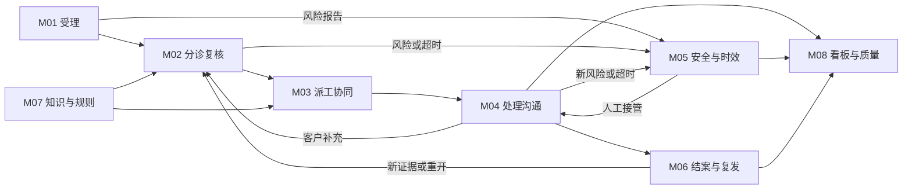

<!--
文档名称：沃太能源售后工单智能分诊与流转模块总览PRD
文件命名：沃太能源售后工单智能分诊与流转模块PRD.md；“模块PRD”在本文件指八个模块的总览与功能要求集合。
文档编号：WT-ASD-MOD-PRD-001
所属系统：沃太能源售后工单智能分诊与流转系统
产品展示名称：沃太售后服务工作台（课程Demo名称，不是沃太现有官方产品名称）
版本：V1.0
编写日期：2026-10-24（Asia/Shanghai）
文档状态：完整方案评审稿，可用于页面原型、需求拆解、开发及功能验收。
上位文档：同目录《沃太能源售后工单智能分诊与流转系统PRD.md》，编号WT-ASD-SYS-PRD-001。
文档层级：模块级总览。定义每个模块解决的问题、用户、入口、功能、规则、协作、异常和验收。
不包含范围：不在本轮生成每个页面的独立PRD、前端代码、数据库实现或真实系统对接方案。
模块命名规则：M01—M08固定；功能需求使用Mxx-Fnn；模块验收使用Mxx-ACnn；页面使用P01—P12。
优先级规则：Must=本地演示必需；Next=试点增强；Later=后续协同。P0—P3仅代表工单严重度。
事实与假设：企业和产品公开事实见系统PRD及调研底稿；本文件的页面/路由/权限/时限为本项目产品要求或演示规则。
输入数据：D:/WoTai-WorkSpace/20261024/mydemo/data；种子版本1.0.0；不使用真实客户数据。
示例要求：文中WO、DEMO、EDGE、CONV编号引用现有模拟数据；新增要求通过GAP差异清单注明，不冒充已经实现。
模型使用方式：预设演示建议与真实模型生成必须显著区分；离线评测不能向模型提供expected或后续处理结果。
业务责任：Agent提供信息与建议；人确认关键操作；系统自动保存、校验、计时和提示，不自动维修、赔付或转移账号。
安全例外：风险提示和入人工接管队列不等待普通审批；接管和后续实际处理由授权人员完成。
权限说明：本地角色切换仅用于演示；真实应用必须在读取和写入时校验权限，不能仅靠隐藏按钮。
兼容说明：GAP01—GAP08见系统PRD；尤其是直接风险升级、有效首响、关闭依据、应急接管和责任队列需补充。
跨文档一致性：模块编号、页面命名、状态语义、人机边界和指标口径以上位系统PRD为准。
维护方式：修改任一模块时，同步受影响模块的输入/输出、原型、演示数据和验收记录；记录版本变更。
-->

# 沃太能源售后工单智能分诊与流转模块总览 PRD

| 项目 | 内容 |
| --- | --- |
| 文档编号 | WT-ASD-MOD-PRD-001 |
| 版本与日期 | V1.0 · 2026-10-24 |
| 所属系统 | 沃太能源售后工单智能分诊与流转系统 |
| 上位文档 | [系统PRD](D:/WoTai-WorkSpace/20261024/mydemo/docs/prd/沃太能源售后工单智能分诊与流转系统PRD.md) |
| 本文作用 | 将系统目标落到8个模块，说明入口、功能、规则、异常和验收，作为后续页面设计与开发依据 |
| 阅读方式 | 先看模块总表和协作，再按模块阅读；公开调研、整体目标与指标见系统PRD |

## 1. 模块与页面命名总表

模块表示业务责任，页面表示用户操作入口。一个页面可以承载多个模块；同一业务动作在不同入口必须遵循相同规则。

| 模块编号 | 固定模块名称 | 业务问题 | 主要页面 | Must首期结果 |
| --- | --- | --- | --- | --- |
| M01 | 客户反馈与工单受理 | 反馈如何变成准确、可追踪的服务记录 | P02工单中心、P03新建与导入、P11我的反馈 | 原文/客户/设备可核对，工单可查询 |
| M02 | AI分诊与人工复核 | 信息不完整、判断依赖经验、建议难核实 | P05 AI复核工作台、P04详情复核区 | 原文证据、缺失项与分诊结论可人工确认 |
| M03 | 派工与资源协同 | 任务交给谁，资源不足如何处理 | P06派工与协同、P04详情派工区 | 负责人明确、交接留痕、资源提案不冒充执行 |
| M04 | 工单处理与客户沟通 | 后续谁跟进，客户如何知道进展 | P04工单详情、P11我的反馈 | 内外消息分开，处理过程与下一步可见 |
| M05 | 安全升级与服务时效 | 风险与积压能否及时被人工接管 | P07风险与超时、P01风险摘要 | 风险旁路、时效清楚、提醒可跟进 |
| M06 | 重复复发与结案管理 | 重复、复发、解决、关闭容易混淆 | P08重复复发与结案、P04关联区 | 人工合并、结果确认、新旧周期保留 |
| M07 | 知识与业务规则 | 判断依据、职责、规则与版本不清楚 | P09知识与规则、P12主数据与权限 | 资料有来源、规则能解释、主数据可核对 |
| M08 | 运营看板与服务质量 | 主管如何识别风险、积压和改进机会 | P01服务总览、P10服务分析 | 指标口径明确、可下钻到具体工单 |

八模块不是八个独立聊天机器人。首期可以由一个分诊Agent执行整理任务，再由工作台承接人工和规则动作；不要求用户理解背后的技术拆分。

## 2. 模块协作与交付物

| 交接 | 交接内容 | 接收方检查 |
| --- | --- | --- |
| M01→M02 | 原始来件、授权客户/设备、发生时间、附件及缺失项 | 不把未知值补成事实；检查风险 |
| M02→M03 | 人工确认的类别、严重度、团队建议和未决事项 | 可用人员、能力、国家/语言与容量 |
| M03→M04 | 已确认的团队/人员、交接原因、协同申请 | 是否有明确负责人、等待条件和后续动作 |
| M04→M05 | 最新风险证据、客户可见响应、进度事件 | 新风险优先；区分回复、接管与修复 |
| M04→M06 | 处理结果、确认依据、候选关联及历史周期 | 是重复、复发还是解决待确认；不能自动关闭 |
| 各模块→M08 | 已发生的业务事件和明确的指标字段 | 统计口径一致、不过度暴露客户资料 |

## 3. M01 客户反馈与工单受理

### 3.1 目标、用户与边界

让客服准确接住一条反馈，让客户只补必要资料。主要用户为客服、客户和安装商。首期支持手工新建和模拟来件导入，不声称已经连接真实邮箱、电话、CRM或客户App。

### 3.2 功能要求

| 需求编号 | 功能与交互 | 业务规则 | 优先级 |
| --- | --- | --- | --- |
| M01-F01 | 新建反馈：选择渠道、客户/站点，录入原文、型号/SN、发生时间、联系偏好和附件 | 允许保存“缺SN”的有效反馈；至少有可理解的描述或人工记录的待澄清说明；风险不能被普通必填项阻塞 | Must |
| M01-F02 | 模拟导入：选择样本，展示总数、成功、重复和失败项 | 一个错误不应无提示地丢弃整批；同一来件引用重复导入需明确处理，不生成重复编号 | Must |
| M01-F03 | 工单中心：搜索编号/SN/摘要，筛选状态、国家、语言、类别、优先级和负责人 | 只检索当前权限内数据；未确认分类/负责人显示待确认；返回列表保留筛选 | Must |
| M01-F04 | 我的反馈：客户查看自身进度、补资料、查看对外回复和确认恢复 | 内部备注和其他客户资料不可见；“确认恢复”不等于客户直接修改内部关闭状态 | Must |
| M01-F05 | 来件质量提示：标记时间不明、型号冲突、疑似多设备、读取失败 | 提示需要核对，不把演示SN格式当作真实产品的合法性规则 | Must |

### 3.3 页面与信息顺序

P03依次呈现“描述问题→关联客户/设备→补充资料→受理结果”。原文区优先，不要求业主先理解技术分类。提交成功显示工单编号和下一步“待复核”；失败保留内容。风险提示固定可见，可直接转人工接管。

P02列表字段为编号、摘要、客户/站点、国家/语言、产品、状态、严重度、负责人、等待/时效。首期默认按风险置顶、到期紧迫程度和创建时间排序；用户可改普通排序，但风险标识不能消失。P11以“当前进度、需要你补什么、最近更新”呈现，避免把内部流转细节全部推给客户。

### 3.4 人机协作与异常

Agent可帮助识别语言和提取字段，客服确认关联设备。提取不到SN时显示未提供，不从相似工单抄入。客户所在地和设备所在地冲突时保留两者并核实。附件缺失、损坏或仅有模糊OCR元数据时，明确说明未能读取并提供重传入口。

### 3.5 输入输出、依赖与验收

输入为客户描述及授权主数据；输出为工单、首条消息和受理记录，交M02；当前风险交M05。对应`reference/customers/sites/devices/products`、`seed/tickets/messages/attachments`。

| 验收编号 | 场景 | 通过条件 |
| --- | --- | --- |
| M01-AC01 | 新建与导入 | 新工单有唯一编号，原文不丢；重复导入可识别；失败项可定位 |
| M01-AC02 | 缺SN/时间、型号冲突 | 可以受理但不伪造字段；查看WO-0161及冲突边界案例 |
| M01-AC03 | 客户视角和权限 | 仅见本组织已授权反馈；内部消息不出现在P11；跨租户请求被拒绝 |
| M01-AC04 | 无结果、损坏附件 | 空态有下一步，读取失败不假称识别成功，编辑内容不丢失 |

## 4. M02 AI分诊与人工复核

### 4.1 目标、用户与边界

帮助客服从客户原话形成可解释的下一步，而非直接下设备根因结论。首期全量建议需人工确认；风险提示和入应急队列是例外旁路，不因等待复核延误。

### 4.2 功能要求

| 需求编号 | 功能与交互 | 业务规则 | 优先级 |
| --- | --- | --- | --- |
| M02-F01 | 原文理解：显示原语言、中文摘要、提取字段及对应证据 | 保留否定、时间范围、推测与确定观察；设备码原样保存 | Must |
| M02-F02 | 分诊建议：类别、严重度、缺失项、团队、下一步和待确认点 | 未知问题交人工；0.8为演示重点复核阈值，不是准确率保证；高分也需确认 | Must |
| M02-F03 | 逐项复核：接受、修改、退回、转人工升级 | 修改类别或严重度后重新检查路由；更正不能覆盖原建议，重要变更记录原因 | Must |
| M02-F04 | 追问与回复草稿：按缺失信息生成客户语言草稿 | 已提供的字段不重复问；未知含义不得编造；对外内容经人工审核 | Must |
| M02-F05 | 新证据再分诊：补充消息到达后展示新旧建议差异 | 安全新证据优先，不被旧的“普通离线”结论覆盖；保留每次建议版本 | Must |

### 4.3 主要操作流程

P05左侧为待复核队列，中间为客户原文/补充消息，右侧为建议与证据。客服先检查风险，再核对设备和现象，选择“确认并进入派工”“审核追问”“修改建议”或“转人工”。必须显示下一步会改变什么；“确认建议”不能自动同时批准保修、关闭或执行设备动作。

来自预设数据的建议显示“预设演示建议”，真实生成显示生成时间及可用状态。建议过期时提示有新来件，要求核对最新证据，不能把旧建议一键套到新风险上。

### 4.4 分类与严重度

沿用14类：connectivity联网、charging充放电、monitoring数据展示、backup备用供电、commissioning安装调试、alarm告警、performance效果收益、account账号授权、warranty保修、cooling温控、dispatch项目通信、ev充电桩、safety风险、unknown待人工。

类别回答“需要什么能力”；P0—P3回答“当前影响多大”。客户强烈催促不直接提升为P0；“没有烟雾”不触发简单关键词升级；当前疑似危险仍优先人工评估。

### 4.5 依赖、输出与异常

输入为M01/M04的新消息和授权设备资料，以及M07的可用规则；输出为建议、证据、人工确认值或追问草稿。AI不可用时可手工填写同样字段并继续，不影响风险直接升级。资料冲突、低可信译文、过长来件和未知故障码显示需核对原因。

### 4.6 验收

| 验收编号 | 场景 | 通过条件 |
| --- | --- | --- |
| M02-AC01 | 人工不同意AI | WO-0015可对照原monitoring与更正后的charging，操作者与时间可追溯 |
| M02-AC02 | 补齐信息/出现危险 | CONV-001补齐后不再追问同字段；CONV-005新烟雾优先进入M05 |
| M02-AC03 | 否定、历史事件和未知码 | 不误称当前起火，不解释未知故障码为真实部件损坏；证据可定位 |
| M02-AC04 | 注入指令/AI失败 | 正文不能改变权限或自动关单；失败可人工继续，不能伪造成功输出 |

## 5. M03 派工与资源协同

### 5.1 目标、用户与边界

让调度把任务交给具备相应能力的人，并保留交接责任。主要用户为调度、区域负责人及技术支持。首期提供演示人员、负载、备件和预约提案，不进行路线优化或真实库存扣减。

### 5.2 功能要求

| 需求编号 | 功能与交互 | 业务规则 | 优先级 |
| --- | --- | --- | --- |
| M03-F01 | 推荐团队/人员：展示国家、技能、语言、当前负载、可用性与理由 | 依据设备所在地；全球组为未知地区/特殊问题兜底；建议不是已分派 | Must |
| M03-F02 | 人工确认派工：核对工单、团队和人员后确认 | 国家/技能/产品范围匹配，人员可用且容量满足；成功后写负责人和分派记录 | Must |
| M03-F03 | 改派与交接：指定新负责人，记录原因和未决事项 | 新接收方确认前原责任不丢失；无可用人进入具名责任的调度队列 | Must |
| M03-F04 | 资源协同：查看备件快照、提出上门/备件需求 | 缺货显示缺货；提案未确认不得显示已发货/已预约；普通工单负责人保持 | Must |
| M03-F05 | 接入真实资源状态、跨团队接收确认 | 按真实业务流程与授权衔接，记录拒收/回退原因 | Next |

### 5.3 页面与用户流程

P06上部显示待派工及资源等待队列，选择工单后可看建议理由与候选人员。确认区明确列出“交给哪个团队、哪位人员、当前负载、需要继续跟进的事项”。修改严重度或设备国家时重新检查候选。

详情中的派工面板与P06共用确认规则。未经确认的建议不能在列表负责人栏冒充正式负责人。连续点击派工只产生一次有效结果；用户操作期间人员变为离线或容量已满，需重新选择或进入队列。

### 5.4 协作与异常

Agent提供排序和解释，人确认人选及协同需求。安装调试问题建议协同安装商，但不能把责任不明确地转给客户。语言不匹配时标记需要翻译或语言协助，不自动改变设备所在国。模拟派工对繁忙、离线、休假、无能力及满容量分别给出明确原因。

当前种子只保留已确认派工；改派待接收和责任队列属GAP05/GAP07增量。真实仓库、预约和退换系统未连接时，界面应明确为本地提案。

### 5.5 输入输出与验收

输入为M02确认结果、团队/人员及资源快照；输出为已确认分派、改派记录或协同需求，交M04。对应`reference/teams/agents/spares`和`seed/assignments/part_requests/visits/rma_requests`。

| 验收编号 | 场景 | 通过条件 |
| --- | --- | --- |
| M03-AC01 | 正常派工 | 国家/技能/容量核对通过，确认后负责人和历史一致，AI建议仍可回看 |
| M03-AC02 | 无人可用/容量满 | 不伪造派工；显示原因和责任队列，不产生无主任务 |
| M03-AC03 | 缺货/预约未确认 | WO-0019、WO-0007准确显示等待原因；不能出现已发货/已预约成功的假状态 |
| M03-AC04 | 重复与并发操作 | 相同提交不重复派工；过期页面提示更新，不覆盖已发生的新分派 |

## 6. M04 工单处理与客户沟通

### 6.1 目标、用户与边界

让负责人持续处理，让客户理解“现在怎样、等待什么、接下来怎样”。主要用户为技术支持、客服、客户与安装商。首期只将外部消息记入本地客户视图，不真实发邮件或短信。

### 6.2 功能要求

| 需求编号 | 功能与交互 | 业务规则 | 优先级 |
| --- | --- | --- | --- |
| M04-F01 | 详情与时间线：汇总设备、原文、建议、人员、对话和处理事件 | 状态快照与最后有效事件一致；未来预约与已发生历史分开 | Must |
| M04-F02 | 对外回复/内部备注：切换可见范围并预览 | 内部内容不自动翻译后发给客户；草稿不显示已发送；客户语言按人工确认内容展示 | Must |
| M04-F03 | 记录进度与等待：处理动作、等待原因、责任人与下一次更新 | 待资料/备件/上门不清空责任；需要资料补充时可以进入待客户补充 | Must |
| M04-F04 | 补充消息进入处理：附件和新证据追加到原记录 | 不覆盖原文；新证据触发M02再分诊和M05风险检查 | Must |
| M04-F05 | 外部沟通渠道与有效首响质检 | 待授权衔接真实发送，增加回复有效性人工标记 | Next |

### 6.3 页面结构与操作

P04顶部显示编号、状态、严重度、客户/站点、负责人和下一步。主体按“原始反馈、对话与处理、AI复核、流转与关联”组织；风险提示固定在重要位置。右侧可展示设备资料、待补充项、等待/时限、派工和协同摘要。

回复编辑区默认保持上次选择的可见范围，但发送前必须再次显著显示范围和对象；首次默认为内部草稿，避免误发。人工点击“记入客户回复”后才进入P11，并记录时间和操作者。失败保留草稿，重复点击不产生重复消息。

### 6.4 处理结果与异常

客户回复“已恢复”后，技术支持填写结果及证据，再交M06确认；不能只凭AI判断完成。发生新危险时先M05，不能把提示埋在普通会话里。附件无法读取、消息提交失败、资料冲突、责任人离线等均应保留原始内容并给出跟进路径。

新增的“下一次更新时间”和等待原因属于GAP05；旧种子无此信息时显示“演示旧记录未采集”，不编造未来承诺。“待客户补充”保留原负责人；返回待复核不意味着自动清空派工。

### 6.5 输入输出与验收

输入为M03派工与M01/M02资料；输出为客户可见消息、内部记录、等待/处理事件和结果，供M05/M06/M08使用。使用`seed/messages/events/tickets`及关联子表。

| 验收编号 | 场景 | 通过条件 |
| --- | --- | --- |
| M04-AC01 | 内外消息分离 | 同一工单内部备注不可从客户视图查看；草稿和已记录回复明确分开 |
| M04-AC02 | 等待和资料补充 | 等待原因和跟进人可见；客户补充追加保存并触发重新检查 |
| M04-AC03 | 时间线 | 先后事件和当前状态一致，未来上门时间只在预约提案里 |
| M04-AC04 | 回复失败与有效首响 | 失败保留草稿；自动回执与内部备注不算人工首响；有效性单独质检 |

## 7. M05 安全升级与服务时效

### 7.1 目标、用户与边界

把可能的危险与超时交给有责任的人，明确“已提示、已入队、人工已接管”之间的差别。主要用户为客服、售后主管和应急负责人；本模块不提供消防或设备维修操作规程。

### 7.2 功能要求

| 需求编号 | 功能与交互 | 业务规则 | 优先级 |
| --- | --- | --- | --- |
| M05-F01 | 当前风险识别与直接升级 | 新来件/新消息即时检查；疑似危险先交人工，缺SN不阻塞；手工风险入口始终可用 | Must |
| M05-F02 | 人工接管队列与确认 | 记录风险发现、入队、接管人、接管时间和下一步；没有接管证据不能显示已接管 | Must |
| M05-F03 | 时效及提醒 | 按当前周期计算首响和普通类解决目标；严格大于到期才超时；提醒去重并可跳到工单 | Must |
| M05-F04 | 跟进与重新评估 | 无人接管交值班责任人/主管跟进；新风险不能自动被撤回或低分级覆盖 | Must |
| M05-F05 | 真实工作日、地区值班及通知衔接 | 由业务确认服务协议、暂停条件、通知对象和升级链后配置 | Next |

### 7.3 交互与接管流程

P07有“当前风险、待人工接管、待首响超时、普通解决目标超时”四个业务视图。风险列表置顶，显示客户观察证据、设备地区、当前责任团队、发现时间和人工接管状态，不以一个绿色分派图标替代接管事实。

客服可点击“立即转人工风险处理”，系统记录理由并入队，下一步由指定应急负责人确认。值班人员点击“确认接管”时填写接管说明和后续更新预期；这只记录服务责任，不等于事故已排除。风险降低或关闭必须由有权限人员记录依据。

### 7.4 计时与P0特殊规则

普通类沿用演示首响与解决目标；P0的15分钟作为演示人工响应目标，30分钟只用于应急接管目标示意，不是修复承诺。旧字段`resolution_due_at`存在不代表有真实接管记录；应急接管计时应依据新增字段（GAP03），未采集显示缺记录。

P0不参与普通解决目标达成率，可单独展示风险未接管与未结束列表。取消和合并排除当前周期SLA；重开保留旧周期。客户长期不回复不触发自动关单。规则提醒产生站内待办，不实际向外发送消息。

### 7.5 异常与验收

AI不可用仍支持人工直接升级；通知失败不影响风险工单本身可见。没有值班人员信息时进入明确的主管责任队列，并提示“责任人员需补齐”，不得显示应急链路已完成。

| 验收编号 | 场景 | 通过条件 |
| --- | --- | --- |
| M05-AC01 | WO-0251缺SN但有危险 | 即时风险提示并进入人工队列，缺资料不挡住；不生成带电/拆机步骤 |
| M05-AC02 | 没有/撤回危险迹象 | 理解否定与时序；CONV-023撤回后由人工重新评估，不直接静默降级 |
| M05-AC03 | 计时边界与提醒 | 12个SLA边界正确；重复运行只生成一个相同提醒；看板可下钻 |
| M05-AC04 | 入队/接管/修复区分 | 无接管记录不能显示已接管；P0不能出现30分钟修复率，未接管持续可见 |

## 8. M06 重复复发与结案管理

### 8.1 目标、用户与边界

让一个问题不被重复处理，让新问题不被旧单掩盖，让关闭有依据。用户为客服、处理负责人和有结案权限的主管；客户可反馈恢复，不能绕过内部确认。

### 8.2 功能要求

| 需求编号 | 功能与交互 | 业务规则 | 优先级 |
| --- | --- | --- | --- |
| M06-F01 | 重复候选对照：两个来件并列显示SN、现象、发生时间、状态、渠道和风险 | 相似度只作提示；不同设备、复发或危险新证据不得自动合并 | Must |
| M06-F02 | 人工合并：选择原单，确认原因与影响 | 保留两个编号、原文、来源及操作证据；被合并单指向原单并排除重复SLA | Must |
| M06-F03 | 解决与关闭：先记录结果，再提交客户确认依据，由授权人关闭 | 结果、证据或确认依据不足时可保存草稿；不能因超时/无回复自动关闭 | Must |
| M06-F04 | 重开或关联新单：选择复发证据与处置方式 | 新周期重新判断并计时；保留旧周期、旧关闭与超时；新危险优先M05 | Must |
| M06-F05 | 评价与案例反馈：客户评价、内部复盘、候选知识 | 演示评价不代表真实口碑；案例去除敏感信息并经审核后才进入知识 | Must（评价查看）/Next（案例发布） |

### 8.3 交互流程

P08按“重复待核对、已解决待确认、复发待处理”展示任务。进入对照后，用户可以“确认合并”“仅关联”“不是同一问题”；不强迫为清空队列而合并。确认合并前显示原单与被合并单的完整编号。

结案区显示处理结果、恢复依据、客户确认及待办清单。点击“标记已解决”与“确认关闭”是两个动作。重开时输入新证据，明确显示新周期和历史周期；对尚未关闭的resolved工单也能重开（GAP04）。

### 8.4 异常与记录

候选原单不存在、已合并、跨客户无授权、产生循环关联时禁止合并并说明原因。客户补充了不同设备或危险新证据，转为独立评估。旧种子关闭记录缺少完整确认材料时，明确展示未采集，不能用模拟满意度倒推已确认。

输出为关联/合并、解决/关闭依据、新周期和评价，供M04、M05、M08；使用`duplicate_candidates/tickets/events/messages/csat`，关闭依据新增见GAP06。

### 8.5 验收

| 验收编号 | 场景 | 通过条件 |
| --- | --- | --- |
| M06-AC01 | WO-0481合并到WO-0004 | 两条来件保留，可从新单到原单，不重复派工或重复计SLA |
| M06-AC02 | 不同设备/新风险 | 不自动合并；安全新信息仍进入人工风险队列 |
| M06-AC03 | 解决与关闭 | 两个动作分开；无依据不能正式关闭；AI没有关闭权限 |
| M06-AC04 | WO-0008复发重开 | 旧响应、解决和超时保留；新周期起点明确，不靠改创建时间覆盖历史 |

## 9. M07 知识与业务规则

### 9.1 目标、用户与边界

让客服知道“建议依据什么、适用于什么产品和地区、是否仍有效”。主要用户为客服、主管和知识维护人员。Must为可查询的只读知识与规则；不要求首期建设完整企业知识治理平台。

### 9.2 功能要求

| 需求编号 | 功能与交互 | 业务规则 | 优先级 |
| --- | --- | --- | --- |
| M07-F01 | 查知识：按问题、产品、语言/地区和资料类型检索 | 保留来源、适用范围、版本、事实/假设标识；无依据时说明未找到 | Must |
| M07-F02 | 查看规则：分类、缺失字段、路由、状态、服务时效和角色 | 演示规则显著标记，不冒充官方保修或真实组织；解释“为何推荐该团队” | Must |
| M07-F03 | 查询主数据与权限：客户/站点/设备、团队/人员、角色范围 | 仅授权内容可查；名单不是派工结果；示例SN不是官方格式标准 | Must |
| M07-F04 | 维护与发布：草稿、审核、生效、停用及历史版本 | 由指定人员审核，禁止AI自行发布规则或把单个回复升级为权威知识 | Next |

### 9.3 页面与交互

P09的资料卡显示标题、内容类型、来源、适用范围和版本；引用到建议时可以回到该卡及官方来源。产品资料与演示业务规则分组标识，搜索无结果时提示人工查证，不生成看似权威的替代答案。

P12以客户/站点/设备与团队/人员两个查询视角提供核对。普通客服不能编辑他人权限；首期不提供真实账号转移与赔付批准操作。知识维护只读页面可以显示“申请修订”，不能用无实际保存的开关伪造规则发布。

### 9.4 协作与异常

Agent只能使用授权且适用的资料。来源不可访问、地区不符、版本不明或资料冲突时标记人工核对，不能把另一地区保修文件当作当前结论。新规则生效不追溯改写旧人工记录，历史建议保留当时使用的版本。

输入为调研来源及演示主数据/规则；输出为M02/M03/M05可用依据。对应`research/sources.json`和`reference/knowledge_base/products/categories/routing_rules/workflow/sla_policies/roles`等。

### 9.5 验收

| 验收编号 | 场景 | 通过条件 |
| --- | --- | --- |
| M07-AC01 | 查看资料与演示规则 | 来源和类型可区分，规则不冒充真实官方承诺 |
| M07-AC02 | 无资料或地区冲突 | 不编造根因或判保；CONV-012需核实地区和版本 |
| M07-AC03 | 主数据权限 | 客户与设备关系可核对，跨租户内容不可通过检索或引用暴露 |
| M07-AC04 | 未实现发布 | 只读和未来维护能力明确，AI不能自行生效新规则 |

## 10. M08 运营看板与服务质量

### 10.1 目标、用户与边界

让主管知道“哪些问题需要现在处理、卡在哪里、是否交接清楚”，并让客服看到自己的待办。指标用于改进服务，不以未经人工验证的AI分数替代绩效评价。

### 10.2 功能要求

| 需求编号 | 功能与交互 | 业务规则 | 优先级 |
| --- | --- | --- | --- |
| M08-F01 | 服务总览：当前风险、待复核、待分派、待补充、未解决和未首响超时 | 每个卡片可下钻至相同条件工单；显示数据范围与演示时钟 | Must |
| M08-F02 | 服务分析：按国家、语言、类别、产品、团队和状态分布 | 未确认类别单独统计；区分当前周期与历史；P0不混入普通解决目标达成率 | Must |
| M08-F03 | 质量复盘：查看AI更正、重复/复发、等待原因和模拟评价 | 修改率不是模型准确率；满意度是模拟值；低样本量不作排名结论 | Must |
| M08-F04 | 有效首响与试点效果：人工质检和前后同口径对照 | 先有真实基线、时间窗和纳入条件；不使用预设正确输出声称业务提升 | Next |

### 10.3 页面与指标口径

P01优先展示行动入口：风险待接管、我的待办和超时积压，再展示总量。P10提供筛选与指标解释，点击图表打开P02并保留对应条件。只读看板不能通过下钻扩大权限。

初始全量演示为492条；未解决397条，排除resolved/closed/cancelled/merged；未首响且超时87条。这里“未首响”指当前周期尚无客户可见人工回复。用户新增、重开、分派或关闭后应按最新记录重算，不能把初始常量永久写成结果。

首期演示数据不提供真实有效首响率、模型准确率或市场占比。待补充180条是样本覆盖设计，不证明公司资料收集存在同等比例的问题。AI建议被接受不等于正确；存在人工更正也不等于该人员处理质量低。

### 10.4 输入输出与异常

从已发生的工单/消息/事件/复核记录计算；尚未执行的提案不计为完成。无数据时显示空态，不用0掩盖加载失败；统计失败显示重试，不能保留旧数字而不标记过期。

### 10.5 验收

| 验收编号 | 场景 | 通过条件 |
| --- | --- | --- |
| M08-AC01 | 初始看板 | 全量492、未解决397、未首响超时87与数据口径一致 |
| M08-AC02 | 下钻与新操作 | 卡片下钻数量一致；本地新增/关闭后看板跟随更新，重置回到种子基线 |
| M08-AC03 | 角色与失败 | 同角色看板和列表范围一致；加载失败不假装0条或成功 |
| M08-AC04 | 指标解释 | P0接管与修复区分，模拟评价及AI接受率不被宣传成真实业务效果 |

## 11. 跨模块一致性与操作要求

### 11.1 共用规则

| 项目 | 全系统一致要求 |
| --- | --- |
| 主键与关联 | 工单、客户、站点、设备、产品及人员用稳定编号关联，不能用列表位置代替 |
| 权限 | 每次读取、检索、下钻和写入均限制到授权范围；内部消息与外部内容分开 |
| 人工确认 | 分派、改派、合并、关闭及重要业务决定有操作者和时间；AI只给建议 |
| 风险例外 | 风险提示与进入人工接管队列可先自动完成；人工接管及后续判断有独立证据 |
| 修改记录 | 原文、旧建议、旧负责人、旧周期结果不被新操作覆盖 |
| 失败与冲突 | 失败保留输入；重复提交不重复执行；页面版本过期先核对最新状态 |
| 时间 | 保存UTC，展示按站点时区并标明；原始时间不明确时待核对，不擅自补齐 |
| 未知字段 | 显示待补充/未核实；不能把null当成0、已拒绝或已完成 |
| 演示标识 | 虚构记录、预设AI建议、文本附件和模拟指标均有明确说明 |

### 11.2 核心业务记录及负责模块

以下为产品需要记录的业务信息，不预设数据库技术。

| 记录 | 维护模块 | 已有基础/增量 |
| --- | --- | --- |
| 来件、工单、原始附件与授权关联 | M01 | 已有；新建时追加 |
| 建议、证据、规则版本、人工修改 | M02 | 已有建议/修改；多版本与运行失败记录需补充 |
| 已确认分派、改派、交接与协同需求 | M03 | 已有确认分派和提案；改派接收及责任队列需补充 |
| 内外消息、等待原因、下一次更新 | M04 | 已有消息/状态；等待原因/更新时间需补充 |
| 风险发现、应急入队、接管与重评 | M05 | 缺独立记录，见GAP02/GAP03 |
| 合并、解决依据、关闭确认、重开周期 | M06 | 已有关联/周期；关闭依据和直接重开跳转需补充 |
| 来源、资料、规则与角色版本 | M07 | 已有只读主数据；审核发布为Next |
| 指标口径、质量标记和试点基线 | M08 | 已有演示合计；有效首响与真实基线为Next |

### 11.3 状态适配补充

系统PRD的GAP01—GAP08是开发适配清单。尤其需要补充系统整理进入待复核的权限、新风险直接升级、处理中再补资料、resolved重开，以及应急接管记录。修改后应同步工作流与验收，不在页面中私自允许与规则不一致的跳转。

## 12. 演示与验收串联

| 场景 | 模块链路 | 推荐数据 | 核心检查 |
| --- | --- | --- | --- |
| 普通离线到处理 | M01→M02→M03→M04→M06→M08 | WO-0001起始或新建模拟反馈 | 每步有业务结果，不只是按钮变色 |
| 缺资料后补齐 | M01→M02→M04→M02→M03 | WO-0161、CONV-001 | 缺失项减少、原文保留、进入下一步 |
| 安全风险缺SN | M01/M04→M05→人工接管 | WO-0251、EDGE-001 | 风险优先、接管记录真实存在、不操作设备 |
| 人工更正AI | M02→M03→M08 | WO-0015 | 原建议、改后值及原因可追溯 |
| 待备件或待上门 | M03→M04→M05 | WO-0019、WO-0007 | 提案与实际执行区分，责任和等待可见 |
| 跨渠道重复 | M01→M06→M04 | WO-0481/WO-0004 | 两编号保留，原单继续处理 |
| 关闭后复发 | M06→M02→M05/M03 | WO-0008、CONV-015 | 新周期建立，历史超时不被删除 |
| 保修授权与提示注入 | M02→M04/M07 | WO-0091、CONV-021 | 不越权判保、转移账号或关闭 |
| 看板与权限 | M08→M01/M04 | dashboard_expected、权限夹具 | 合计、下钻和可见范围一致 |

Must完成标准：八模块的首期功能都有对应入口，正常链路可操作，指定异常有清楚结果，新增业务记录能被详情与看板一致反映。只展示静态页面或预设卡片不算已实现人工确认后的业务变化。真实AI未连接时允许用预设建议演示，但必须标明。

验收输入与预期分开使用：`evaluation/inputs.jsonl`作为模型来件；`expected.jsonl`由评估方读取；不能把答案和后续结果放进模型输入。76个边界案例及24组连续对话是功能测试素材，不是已自动运行通过的应用测试记录。

## 13. 开发顺序、依据与版本

推荐先完成M01/M04的工单与对话底座、M07只读资料，再接M02复核和M03派工；M05风险旁路应与首条来件同时具备，不能留到最后；随后完成M06与M08。页面拆分与具体实现方式由后续开发决定，但业务边界和验收口径应保持一致。

业务背景和公开来源见[系统PRD](D:/WoTai-WorkSpace/20261024/mydemo/docs/prd/沃太能源售后工单智能分诊与流转系统PRD.md)与[调研底稿](D:/WoTai-WorkSpace/20261024/mydemo/data/research/公开信息调研与业务假设.md)。字段、数据目录和已有校验见[数据使用说明](D:/WoTai-WorkSpace/20261024/mydemo/data/README.md)与[字段字典](D:/WoTai-WorkSpace/20261024/mydemo/data/docs/字段字典.md)。

| 版本 | 日期 | 变更 |
| --- | --- | --- |
| V1.0 | 2026-10-24 | 首版八模块总览；功能编号、12页入口、人机分工、异常、输入输出与模块验收 |
