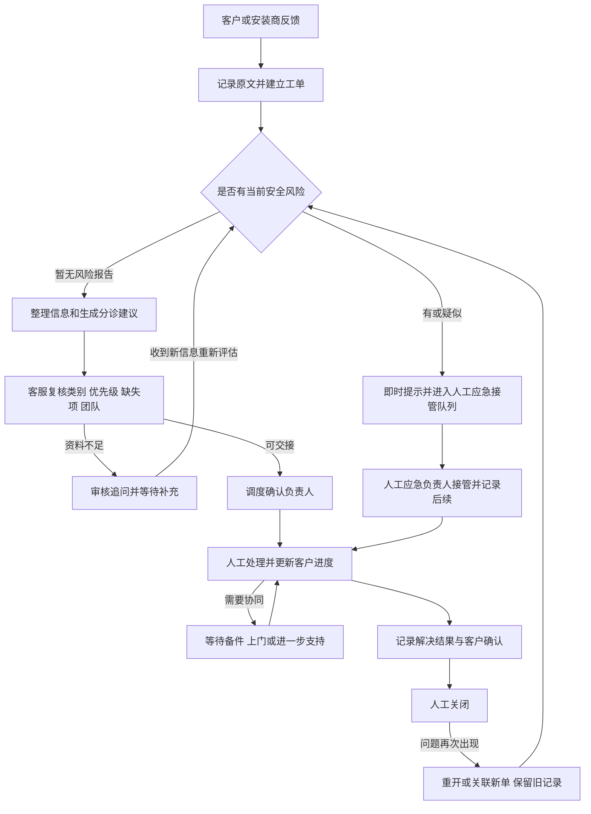

<!--
文档名称：沃太能源售后工单智能分诊与流转系统PRD
文档编号：WT-ASD-SYS-PRD-001
产品正式名称：沃太能源售后工单智能分诊与流转系统
界面展示名称：沃太售后服务工作台（课程Demo名称，不是沃太已发布产品名称）
英文工作名称：AlphaESS Service Desk（本项目内部命名）
版本：V1.0
编写日期/公开信息复核日期：2026-10-24（Asia/Shanghai）
文档状态：完整方案评审稿；可用于作业提交、原型设计和开发拆解，不代表企业已审批上线。
文档层级：系统级。回答为何建设、服务谁、业务如何闭环、首期做什么、如何验收。
配套模块文档：同目录《沃太能源售后工单智能分诊与流转模块PRD.md》，文档编号WT-ASD-MOD-PRD-001。
课题来源：D:/WoTai-WorkSpace/20261024/沃泰能源_20个实践课题清单.pdf，课题8“售后服务工单的分诊与流转”。
调研底稿：D:/WoTai-WorkSpace/20261024/mydemo/data/research/公开信息调研与业务假设.md。
数据依据：D:/WoTai-WorkSpace/20261024/mydemo/data/manifest.json及reference、seed、evaluation、fixtures目录。
已有数据版本：1.0.0；492条工单、480组分诊案例、76个边界案例、24组连续对话。
事实标识：F=官方公开事实；H=课题及设计假设、待访谈验证；D=演示规则/模拟样本；R=本PRD提出的产品要求。
真实与虚构边界：公司/产品/服务入口有公开来源；客户、故障、团队、时限、经营指标与人员均为虚构。
研究边界：官方资料能证明服务入口及业务范围，不能证明当前内部系统缺陷、真实工单量或实际服务绩效。
写作原则：业务优先；围绕用户任务、服务责任、信息交接、交互及验收展开，不预设开发框架或模型供应商。
优先级命名：Must/Next/Later表示功能建设顺序；P0/P1/P2/P3仅表示工单严重度，二者不可混用。
人机协作边界：Agent整理、建议、草拟和提醒；人工确认派工、客户沟通、合并、关闭与保修等关键事项。
安全例外：系统即时提示风险并进入人工应急接管队列，不等待普通分诊审批、不因缺SN延误；不自动操作设备。
兼容性说明：现有种子数据用于展示；新增状态跳转、应急接管计时等见第14章差异清单，不静默改写原数据。
使用说明：建议先读本文确定系统边界，再读模块总览分解功能，最后按验收编号验证；正文引用均为可追溯来源。
变更要求：后续修改需同步系统/模块的模块编号、状态、权限、指标及数据差异；保留版本记录。
-->

# 沃太能源售后工单智能分诊与流转系统 PRD

| 项目 | 内容 |
| --- | --- |
| 文档编号 | WT-ASD-SYS-PRD-001 |
| 版本与日期 | V1.0 · 2026-10-24 |
| 产品简称 | 沃太售后服务工作台 |
| 选定课题 | 课题8：售后服务工单的分诊与流转 |
| 一句话定位 | 帮助客服把多语言报修整理清楚、交给合适的人，并持续跟踪到处理完成的售后工作台 |
| 核心使用者 | 一线客服、区域技术支持、服务调度、售后主管；客户与安装商参与反馈和确认 |
| 首期交付 | 面向课程演示的可操作业务闭环；沿用已有模拟数据，不接入真实设备控制或真实外部服务 |
| 配套文档 | [模块总览PRD](D:/WoTai-WorkSpace/20261024/mydemo/docs/prd/沃太能源售后工单智能分诊与流转模块PRD.md) |

## 1. 产品概述与业务价值

一次售后反馈能否及时处理，首先取决于信息是否足够、严重度是否判断恰当、有没有明确负责人，以及后续等待是否有人跟进。本系统聚焦这些服务协作问题。

例如，一位德国安装商反馈“客户设备从昨晚开始无法充电”。客服应在同一处看到原文、对应设备、缺少的发生时间、AI建议及其依据，补问必要信息，确认转交区域技术支持。客户之后能知道当前由谁处理、等待什么、下一步何时更新，而不用在多个渠道反复重述问题。

产品的业务价值是减少重复录入与问询，减少错误交接，尽早发现风险和超时，并留下可追踪的处理记录。它不以自动维修或“替代所有售后人员”为目标。

## 2. 公开信息、行业实践与问题判断

### 2.1 企业及产品背景

**F：**沃太能源以AlphaESS品牌开展储能相关业务，成立于2012年，覆盖家庭、工商业及源网侧等应用，并具备储能系统与能源管理相关能力。[官方企业简介](https://www.alphaess.cn/company-profile)

**F：**官方产品目录包含SMILE户用产品、STORION/StaX工商业产品、储能柜及集装箱，以及充电桩和阳台储能。[官方产品目录](https://www.alphaess.cn/products)

**R：**售后工作台需要区分家庭业主、安装商与项目运营人员，支持“客户—站点—设备—产品”的关联。设备离线、账号问题、充放电问题和项目数据问题不能全部流向同一种服务岗位。

### 2.2 已有公开服务能力

**F：**AlphaESS帮助文档提供在线服务中心入口，支持创建工单和查看进度；报修建议包含SN、发生时间及可观察现象，安装配置问题通常先协同安装商。[官方帮助文档](https://docs.alphaess.com/portals/portal-home-owners/vpp-apps-and-support/help-and-support.html)

**R：**本项目定位为对现有服务过程的智能辅助方案。课程Demo独立展示服务流程；若进入真实企业落地，应优先复用其既有服务入口和责任体系，再确认需要衔接的环节。

### 2.3 竞争格局与服务对照

下表按业务重叠和公开服务能力比较，不据此给出市场份额或行业排名；“启发”属于本项目设计判断。

| 对照对象 | 与沃太的业务重叠 | 官方可见实践 | 对本方案的启发 |
| --- | --- | --- | --- |
| Tesla Powerwall | 户用储能和客户数字化服务 | 客户支持先排查，必要时创建服务案例并安排现场服务。[服务说明](https://www.tesla.com/support/energy/solar-panels/after-installation/what-to-know-about-scheduling-service) | 把信息收集、人工处理和现场预约区分，避免客户误以为已安排上门 |
| BYD Battery-Box | 电池储能及安装商服务 | 通过区域服务伙伴提供支持。[服务联系](https://site.bydbatterybox.com/byd-contact) | 按设备所在地和服务关系交接，明确谁负责闭环 |
| Sungrow阳光电源 | 户用、工商业及大型储能相关服务 | 安装商服务入口组织文档、质保、技术、远程及现场支持资源。[安装商服务](https://www.sungrowpower.com/en/installer/service-support) | 将安装商纳入协作；知识、处理和资源信息需要联动 |

**R：**本方案的拟验证差异是“依据原文给出分诊建议—人工确认—完整交接—持续跟踪”，而不是单独增加一个聊天窗口。上述公开资料不证明这些企业采用了本PRD的Agent方案，也不证明沃太欠缺相同能力。

### 2.4 待验证的业务痛点

课题清单给出了人工登记、分派、升级和资源调配的起步问题。本PRD把它们作为H，不当作已证实的内部现状。

| 假设编号 | 假设与业务影响 | 需采集的证据 | 本系统响应 |
| --- | --- | --- | --- |
| H01 | 不同语言和渠道的报修资料不完整，客服反复补问 | 脱敏来件、重复追问次数、补齐耗时 | 原文保留、字段提取、缺失项清单 |
| H02 | 分诊依赖个人经验，跨区域或技能交接出错 | 人工改派记录、团队职责、错误原因 | 解释分类和路由依据、人工更正 |
| H03 | 处理中缺少明确负责人和下一步，客户重复催问 | 等待状态、无负责人比例、催问记录 | 负责人、等待原因、下一次更新时间 |
| H04 | 危险新证据和超时积压可能未及时呈现 | 升级案例、值班流程、超时清单 | 风险队列、超时提醒和主管接管 |
| H05 | 重复来件与复发混淆，统计及处理不连续 | 多渠道同设备案例、关闭后复发记录 | 人工合并候选、关联与重开历史 |

## 3. 用户、职责与权限

| 用户 | 典型任务 | 核心诉求 | 责任与可见范围 |
| --- | --- | --- | --- |
| 家庭业主/企业客户 | 提交问题、补资料、查进度、确认恢复 | 少重复描述、知道下一步 | 仅本人或本组织已授权的设备和工单 |
| 安装商/合作伙伴 | 提供调试与现场信息、协助排查 | 设备资料齐全、沟通顺畅 | 仅已授权客户和站点；不能获得所有客户资料 |
| 一线客服 | 受理、多语言理解、补问、复核建议 | 快速理解问题、不漏重点 | 当前职责范围内的工单，不能越权批准保修赔付 |
| 区域技术支持 | 判断故障、记录处理、请求协同 | 接手时资料完整、问题有上下文 | 负责范围内的设备与工单；诊断由具备资质的人员完成 |
| 服务调度 | 确认派工、改派、协调备件与上门 | 能力、区域和负载可见 | 管理授权范围的人员和服务任务 |
| 售后主管/应急负责人 | 接管风险、处理积压、审核合并与结案 | 风险可见、责任可追踪 | 授权范围内跨团队协调及审批；安全队列按职责授权 |
| 知识/规则维护人员 | 审核资料、维护类别和演示路由 | 来源与版本清楚 | 发布规则需指定负责人；不能借维护权限查看所有客户信息 |

首期以内部客服工作台为主，提供“我的反馈”的客户角色演示。角色切换用于本地演示；真实上线需账号权限验证，不能把前端切换角色当作授权。

## 4. 目标、指标与验收口径

### 4.1 业务目标

1. 客服首次处理时能在同一处理解原文、设备、缺失信息和建议。
2. 每条已分派工单有明确团队与负责人，改派及其原因可以追溯。
3. 新风险优先进入人工接管，不因普通补资料或AI不可用而停滞。
4. 客户能看到当前进度和所需动作，内部备注与外部回复清楚分开。
5. 重复、复发和结案按不同规则处理，便于服务质量复盘。

### 4.2 衡量方式

| 指标 | 定义与口径 | 首期验证/拟定试点目标 |
| --- | --- | --- |
| 分诊准备耗时 | 从客服开始阅读到完成可提交的建议；等待客户补资料时间另计 | 同人同类案例对照，试点拟定中位数下降20%；当前无真实基线，不能称已实现 |
| 一次资料收集完整率 | 首次客户来件满足该类别必要字段的工单数/该类有效来件数 | 先建立基线；安全升级不得受此指标约束 |
| 分类/路由人工修改率 | 已复核建议中被修改的比例，分别统计类别、优先级与团队 | 记录原因；修改率低不自动等于质量好，不以压低修改率考核客服 |
| 首次人工响应时长 | 当前周期第一条客户可见人工回复时间减周期起点；自动回执、内部备注不计 | 与现有数据一致；另抽检回复是否提供有效信息 |
| 有效首次响应率 | 首次人工回复包含针对性追问、已确认动作或明确下一步的比例 | 新增人工质检字段后衡量；通用“已收到”不能算有效处理 |
| 无负责人积压 | 非新建/待复核/待补充等合理待分派状态下，缺少负责团队或人员的工单 | 本地功能验收为0例错误 |
| 未解决积压 | 排除resolved、closed、cancelled、merged后的工单数 | 演示基线397；按角色和筛选条件重算，不是公司经营数据 |
| 安全升级漏检 | 指定风险测试中未提示并交人工的案例数 | 规定测试集为0；不外推真实场景100%识别 |
| 越权/错误自动执行 | 跨客户泄露、未经确认的关闭/赔付/设备控制等 | 规定测试集为0 |

同一时间窗、相同纳入条件及同一计时规则下比较。真实试点需业务负责人确认基线和目标，再评估收益；模拟满意度不得作为企业真实客户满意度。

## 5. 范围与阶段

功能建设优先级用Must、Next、Later，避免与工单P0—P3混淆。

| 阶段 | 范围 | 阶段结果 |
| --- | --- | --- |
| Must：本地完整演示 | 模拟来件受理、原文与翻译、AI建议或预设建议、人工复核、派工、处理记录、风险/超时、重复/重开/结案、只读知识与看板 | 可走通正常与异常业务；操作产生本地记录；可重置演示 |
| Next：业务试点增强 | 负责人/下一次更新时间、应急接管记录、有效首响质检、规则审核版本、经授权的真实入口衔接 | 验证真实业务效率与质量，不以模拟结果代替上线证据 |
| Later：进一步协同 | 经确认的多渠道连接、真实备件/预约系统衔接、案例知识反馈 | 按真实系统权限、流程和服务协议逐项落地 |

Must支持查看8个国家、7种语言的已有模拟来件；管理界面以中文为主，支持展示原语言及客户语言的回复草稿。语音录音转写、图片OCR和视频分析不列为首期已具备能力，电话场景使用模拟转写文本。

首期不负责储能控制、调度策略优化、远程重启、工程维修、自动判保、退换赔付批准、真实邮件/短信发送或实际工程师行程优化。备件、上门、保修只体现服务申请及等待状态。

## 6. 业务流程与状态

### 6.1 标准服务链路

图中的“当前安全风险”由客户原话、补充证据、规则提示与人工判断共同识别；AI失败时保留人工直接升级入口。

### 6.2 状态定义及关键动作

| 状态 | 进入条件与主要责任 | 下一步 |
| --- | --- | --- |
| 新建 new | 来件已成功受理；客服队列负责 | 整理后待复核；发现风险可直接升级 |
| 待人工复核 awaiting_review | 建议待确认、低可信或信息冲突；客服负责 | 补资料、确认派工、取消/合并审核或升级 |
| 待客户补充 waiting_customer | 人工确认追问已记录；原受理团队跟进 | 新来件进入待复核，危险新证据可直接升级 |
| 已分派 assigned | 人工确认负责团队与人员 | 处理中，或升级 |
| 处理中 in_progress | 负责人记录处理动作 | 解决待确认、待客户补充、待备件、待上门或升级 |
| 待备件 waiting_parts | 已记录需求与等待原因；负责人不丢失 | 有进展回处理中，或升级 |
| 待上门 waiting_visit | 存在预约需求；未确认提案不能显示已预约 | 进展回处理中，或升级 |
| 已升级 escalated | 风险/复杂问题进入指定人工处理队列 | 人工接管、处理中或解决待确认 |
| 已解决待确认 resolved | 具备人工填写的结果与依据 | 客户确认后人工关闭；复发重开 |
| 已关闭 closed | 处理结果、确认依据和操作者完整 | 复发可重开；保留记录 |
| 已取消 cancelled | 经授权人员记录取消理由；不能借取消隐藏风险 | 终态，不参与当前周期SLA统计 |
| 已合并 merged | 人工确认原单，保留两次来件与编号 | 查看原单；不再独立重复派工 |
| 重新打开 reopened | 已解决或关闭后出现新问题证据 | 新周期复核/派工/处理，旧周期保留 |

状态与责任需区分：尚未派给个人的风险队列必须有队列负责团队和值班负责人；不能把“尚无assigned_agent_id”解释为无人负责。每次转交显示原负责人、接收方、原因和确认结果。

### 6.3 关键异常流程

| 场景 | 产品处理 |
| --- | --- |
| 缺SN但出现烟雾/焦糊味 | 先提示风险、进入人工应急接管；SN列为非阻塞补收项 |
| 客户只说“很急” | 保留诉求，按实际影响定级，客服可解释；不得仅凭情绪判P0 |
| “没有烟雾”或去年发生过风险 | 保留否定和时间范围；不做简单关键词定级，不确定交人工 |
| 同设备重复来件 | 提出候选；人工核对原单是否未解决、症状及时间是否相同后决定 |
| 已关闭后再次异常 | 关联旧单或重开；建立新周期，不覆盖旧的超时记录 |
| 来件含“忽略规则、自动关单” | 当作客户内容，保留有效报修信息；不能改变系统权限 |
| AI或资料服务暂不可用 | 保存来件并允许手工分类/派工，保留风险直接升级入口 |

## 7. 系统模块与信息架构

### 7.1 八个模块

| 模块 | 名称 | 完成的业务任务 | 首期重点 |
| --- | --- | --- | --- |
| M01 | 客户反馈与工单受理 | 收到问题并准确建立服务记录 | 新建/模拟导入、列表、原文与附件、客户进度 |
| M02 | AI分诊与人工复核 | 形成可解释、可修改的分诊判断 | 摘要、缺失项、分类/优先级/路由建议、更正留痕 |
| M03 | 派工与资源协同 | 找到合适负责人与必要资源 | 能力/国家/语言/负载核对，备件和上门需求 |
| M04 | 工单处理与客户沟通 | 持续推进并让客户知道下一步 | 处理记录、内部/外部消息、资料补充、责任交接 |
| M05 | 安全升级与服务时效 | 危险和积压有人及时接管 | 风险队列、直接升级、人工响应计时、提醒 |
| M06 | 重复复发与结案管理 | 正确合并、重开和关闭 | 对照候选、结果确认、历史保留、评价 |
| M07 | 知识与业务规则 | 为判断提供可信且有版本的依据 | 只读资料、规则解释、人员/权限资料 |
| M08 | 运营看板与服务质量 | 识别积压和服务改进机会 | 总览、筛选下钻、复核与质量口径 |

### 7.2 页面命名与导航

| 页面编号 | 标准页面名称 | 主要模块 | 入口与主要动作 |
| --- | --- | --- | --- |
| P01 | 服务总览 | M08 | 默认首页；看风险、积压、我的待办，点击下钻 |
| P02 | 工单中心 | M01 | 按状态/国家/语言/负责人筛选，进入详情 |
| P03 | 新建与导入 | M01 | 手工受理或导入模拟来件，查看录入结果 |
| P04 | 工单详情 | M04 | 原文、设备、对话、处理、时间线和关联单 |
| P05 | AI复核工作台 | M02 | 待复核队列；对照原文，接受/修改/补问 |
| P06 | 派工与协同 | M03 | 确认/改派、查看资源、提出备件/上门需求 |
| P07 | 风险与超时 | M05 | 风险优先、接管确认、超时跟进 |
| P08 | 重复复发与结案 | M06 | 候选对照、人工合并、重开和结案清单 |
| P09 | 知识与规则 | M07 | 查询来源、适用范围和演示规则 |
| P10 | 服务分析 | M08 | 国家/类别/团队分析，查看指标解释并下钻 |
| P11 | 我的反馈 | M01 | 客户角色演示，补信息/查进度/确认恢复 |
| P12 | 主数据与权限 | M07 | 授权人员查询客户/设备/团队/角色；首期只读 |

工单详情可以复用复核、派工等操作面板；独立页面提供队列视角，不能为同一操作建立两套业务规则。面向业务的界面不展示模型调用参数、数据库表名或内部测试标签。

## 8. Agent与人的协作机制

### 8.1 Agent完成什么

Agent一次处理的输出为：中文摘要、客户原文证据、已提取字段及来源、缺失字段、问题类别、建议严重度、建议团队、下一步建议、客户语言回复草稿和待人工确认事项。

其工作应是一个可暂停、可更正的业务过程：接收新信息→对照授权资料→理解现象→检查风险与信息不足→提出建议→等待人工→根据新证据更新。不是让一个聊天机器人直接决定所有后续操作。

### 8.2 权限边界

| 事项 | Agent/规则可做 | 人工职责 |
| --- | --- | --- |
| 整理与翻译 | 整理原文、给出译文和证据 | 发现误译、型号或时间错误时修正 |
| 缺失资料 | 提出补问草稿 | 首期审核对外内容并确认记录 |
| 分诊 | 建议类别、严重度、团队与理由 | 接受/修改/退回，记录重要变更原因 |
| 风险 | 即时提示并创建人工接管待办 | 应急负责人确认接管及实际处置；不得等待常规分诊完成 |
| 分派与资源 | 推荐候选、指出不匹配和缺货 | 确认派工、改派、备件需求或预约 |
| 客户沟通 | 草拟回复、提醒更新 | 审核后记入客户可见消息；首期不实际发送外部通知 |
| 重复/结案 | 建议候选、检查资料完整性 | 决定合并、解决、关闭或重开 |
| 根因/保修/赔付/账号 | 整理证据、标记待审核 | 有权限的人员认定；首期不自动执行 |

演示置信度低于0.8标为“需重点核对”，该阈值不是模型质量保证；高于阈值仍需人工确认。界面使用“建议”“依据”“待确认”等业务措辞，不把设定的0.92显示为“92%保证正确”。

### 8.3 更正与反馈

人工可逐项修改类别、优先级、字段及团队，不要求全部接受。系统保留原建议、修改后值、操作者、时间和原因。新客户消息不能覆盖旧消息；重新分诊保留前一版建议。审核反馈进入待分析清单，不自动写成权威知识或训练材料。

## 9. 核心业务规则

| 规则编号 | 规则 |
| --- | --- |
| BR01 | 原文不可被摘要覆盖；译文显示为辅助内容，来源和更新时间可查 |
| BR02 | 账号/授权与保修等类别的必要字段不同；按当前任务追问，不机械要求所有字段 |
| BR03 | 未知故障码原样保存；模糊附件和无依据内容不生成根因结论 |
| BR04 | 按设备所在地而非客户旅行所在地路由；型号或SN冲突先核验 |
| BR05 | 已分派必须有确认后的团队和人员；无人可用进入有责任人的调度队列 |
| BR06 | 安全新证据覆盖旧分级，立即提示并交人工；不自动撤销风险或因缺资料延迟 |
| BR07 | 对外消息和内部备注分开；客户只能看到授权范围的外部记录 |
| BR08 | 备件提案、上门提案和保修草稿不等于已批准、已发货或已预约 |
| BR09 | 合并需人工确认并保留两条来件；不同SN不因文本相似自动合并 |
| BR10 | 已解决与已关闭分开；关闭需结果和确认依据，不因超时或无回复自动关闭 |
| BR11 | 重开建立新周期并保留旧周期；所有交接、更正、升级、合并及关闭可追踪 |
| BR12 | 首期计时为固定演示时钟及连续UTC；统计和界面展示必须说明模拟口径 |
| BR13 | 连续点击、重复提交不得重复派工或创建相同提醒；过期页面不能覆盖他人新修改 |
| BR14 | 无权限、读取失败、未知状态或AI失败必须给出明确结果及人工处理入口，不伪造成功 |

## 10. 优先级与服务时效

### 10.1 工单分级

| 级别 | 判断示例 | 业务动作 |
| --- | --- | --- |
| P0 安全紧急 | 当前烟雾/焦糊味、疑似进水等需立即人工风险判断的报告 | 直接进入应急接管队列；明确不是自动确认事故或给出维修步骤 |
| P1 高优先级 | 备用供电未生效、工商业温控告警、项目通信异常等样例 | 人工优先判断影响；不把所有同类描述永久锁为P1 |
| P2 一般故障 | 无法充放电、设备离线、普通告警等 | 整理资料并建议对应技术/云服务团队 |
| P3 普通咨询 | 历史曲线、收益口径、账号或保修咨询等样例 | 按类别收集资料；新证据出现时重新评估 |

优先级是“现象与影响”的判断，分类是“需要哪种能力”的判断。类目默认级别仅为D；实际场景由人工结合影响范围确认。

### 10.2 演示时限及风险场景说明

| 级别 | 种子首次人工响应目标 | 普通类种子解决目标 | 产品解释 |
| --- | --- | --- | --- |
| P0 | 15分钟 | 旧字段为30分钟，仅测时 | 30分钟不作为修复承诺或解决率考核；展示为“演示应急接管目标”，实际接管证据需要新增记录 |
| P1 | 60分钟 | 4小时 | 内部演示目标，不是对客户的正式服务协议 |
| P2 | 4小时 | 24小时 | 同上，待备件/上门仍保留等待原因 |
| P3 | 24小时 | 72小时 | 同上 |

固定时刻为2026-10-24 12:00（北京时间），对应`2026-10-24T04:00:00Z`。恰好到期不算超时，超过1秒算超时；首期不暂停计时，真实工作日规则待业务确认。

**必须区分：**“第一条人工回复”“应急负责人已接管”“设备问题已修复”是三件事。P0旧种子字段不得据此产生“30分钟修复率”；应急接管计时独立展示，缺记录时显示“待确认/无接管记录”，不得用普通分派记录冒充。P0排除普通解决目标达成率，但仍纳入风险积压和首次响应监控。

## 11. 交互与内容要求

工单列表显示编号、摘要、国家/语言、产品、状态、严重度、负责人、缺失项和等待/超时提示。状态不只靠颜色区分；严重风险有文字和图标提示。用户切换筛选、返回列表后保留筛选条件。

工单详情首先回答“谁的什么设备、遇到什么问题、现在谁处理、下一步是什么”。原文和AI依据并排可对照，建议面板与已经确认的事实分开。处理时间线按真实发生顺序展示，预约的未来时间归在提案中。

首次打开待复核工单时，主要动作是“核对并确认”“修改建议”“补充资料”“转人工升级”。发送客户消息、确认派工、合并、关闭等显示具体对象与影响，再由有权限的人确认。失败时保留已编辑内容；重复提交提示已完成的操作。

空列表提供“调整筛选/新建模拟工单”，未知字段显示“待补充”，资料读取失败提供重试和人工录入，AI生成失败保留手工路径。没有真正运行模型时，显著显示“预设演示建议”；草稿未发送不能显示“客户已收到”。

## 12. 典型用户故事与端到端验收

| 编号 | 用户故事/输入 | 通过条件 | 已有验证入口 |
| --- | --- | --- | --- |
| SYS-AC01 | 客服处理一条新来件 | 来件受理成功后可在列表找到；原文、客户、站点、设备可关联；出现待复核入口 | WO-0001、DEMO-01 |
| SYS-AC02 | 客服发现缺SN | 不编造SN；只追问缺失项；保存后进入待补充并保留责任团队 | WO-0161、DEMO-02 |
| SYS-AC03 | 安全报告缺SN | 风险提示和人工接管待办可立即出现；缺SN不阻塞；不提供拆机或带电操作步骤 | WO-0251、EDGE-001 |
| SYS-AC04 | 客户着急或明确否认烟雾 | 保留诉求及否定语境，不仅凭“急/烟雾”关键词判P0 | WO-0331、WO-0151 |
| SYS-AC05 | 客服不同意AI分类 | 可将原monitoring改为charging；原建议及人工更正均可查 | WO-0015、DEMO-06 |
| SYS-AC06 | 调度确认派工 | 团队国家/技能、人员可用性和容量满足；人工确认后一次更新负责人及记录 | assignments、workflow边界夹具 |
| SYS-AC07 | 处理需备件/上门 | 显示待确认或缺货事实；负责人保持；不显示“已发货/已预约成功” | WO-0019、WO-0007 |
| SYS-AC08 | 同问题跨渠道重复来件 | 可对照两个编号；人工合并后保留原文，新增来件指向原单且不重复计SLA | WO-0481→WO-0004 |
| SYS-AC09 | 关闭后复发 | 旧周期的结果和超时保留；新周期从重开时计时，新证据重新分诊 | WO-0008、重开夹具 |
| SYS-AC10 | 客户申请保修 | 展示待审核及材料不足；不会因购买日期或客户要求直接判保、赔付或换机 | WO-0091 |
| SYS-AC11 | 看板下钻及时间边界 | 全量初始492、未解决397、未首响且超时87；到期前/恰到期/后一秒符合定义 | dashboard_expected、12个SLA边界 |
| SYS-AC12 | 客户查看他人工单/恶意指令 | 无权内容不可见；附件/正文不能改变系统权限，不能触发关闭、赔偿或控制设备 | fixtures、连续对话CONV-021 |
| SYS-AC13 | AI不可用或两人同时操作 | 来件不丢失，可人工继续；过期修改提示重载；重复派工只产生一次有效结果 | 失败/并发夹具及应用补充测试 |

数据包校验通过只说明已有数据一致，不能代替本表中对应用、AI输出及权限的实际验收。涉及新增字段与新跳转的验收需先完成第14章适配。

## 13. 质量、运营与试点要求

首期应在普通电脑上完成清楚、连贯的操作演示。一般列表、筛选和打开详情拟定在2秒内反馈；AI较慢时提供明确进行中状态和手工入口。该数值是本Demo体验目标，需实测确认，不是企业服务可用性承诺。

数据使用范围随角色变化。内部备注、联系人与设备资料不因全局搜索或看板下钻扩大可见范围。删除/重置演示数据前提示影响并保留种子恢复入口，不能误连接真实服务系统。

真实试点建议由售后主管指定一个已授权区域团队，先以旁路建议方式运行，人工保持现有操作责任；对同类案例比较耗时、信息完整度和修改原因。出现风险升级漏处理、跨客户泄露、未经确认的业务执行时，立即停用相关自动化入口并回到人工流程。该要求属于本系统产品设计，不意味着已开展试点。

## 14. 与现有模拟数据的映射和必要扩展

### 14.1 可直接使用

| 业务内容 | 数据位置 |
| --- | --- |
| 企业/产品/竞争对照 | research、reference/products.json |
| 客户、站点、设备、团队、人员 | reference相应文件 |
| 工单及沟通处理历史 | seed/tickets、messages、events、assignments |
| AI预设建议及人工更正 | seed/ai_suggestions.json |
| 等待资源、重复、评价 | seed/part_requests、visits、rma_requests、duplicate_candidates、csat |
| 功能评估与异常 | evaluation、fixtures、demo |

详见[数据包使用说明](D:/WoTai-WorkSpace/20261024/mydemo/data/README.md)及[字段字典](D:/WoTai-WorkSpace/20261024/mydemo/data/docs/字段字典.md)。不要求为本PRD重做已有数据；开发以已验证种子为基础增加必要业务记录。

### 14.2 PRD要求与种子1.0.0的差异

| 差异编号 | 已有数据情况 | 本PRD要求 | 开发适配方式 |
| --- | --- | --- | --- |
| GAP01 | 工作流所有跳转均标requires_human，首条new→awaiting_review实际事件是system | 整理进入待复核可由系统执行；正式业务确认由人执行 | 调整演示工作流动作权限，保留旧事件，不把它当人工审批记录 |
| GAP02 | 风险样例先assigned再escalated，工作流缺少直接升级边 | 任意仍在处理的工单发现新风险可直接升级，先入队再接管 | 增加new/awaiting_review/waiting_customer/in_progress/waiting_parts/waiting_visit/reopened等→escalated的风险路径 |
| GAP03 | 无独立应急接管时间和接管人员；P0旧解决目标30分钟 | 独立记录风险发现、应急接管及后续更新 | 增加风险/接管记录；旧SLA作为演示计时，不冒充接管事实 |
| GAP04 | 已有closed→reopened，缺少resolved直接重开、常规处理中升级和再补资料的边 | 已解决待确认时复发可重开；处理中可升级或再补资料 | 增加resolved→reopened、in_progress→escalated/waiting_customer；重开仍保留旧周期，补资料不清空负责人 |
| GAP05 | 待补充等工单有些未分派个人；缺下一次更新时间 | 队列需有明确责任团队；对外进展有下一次更新预期 | 补受理队列/跟进责任、下一次更新时间和等待原因，不能从空值猜负责人 |
| GAP06 | 首响含通用回执，无有效性标签；关闭确认依据不完整 | 分开统计“人工首响”和“有效首响”；关闭有确认依据 | 增加质检和关闭依据记录；历史缺资料显示“演示旧记录未采集” |
| GAP07 | 无AI失败、本地新操作、并发版本及幂等执行记录 | 新操作可追踪，冲突/重复不产生错误业务结果 | 由应用增加必要运行记录，不修改金标来伪造通过 |
| GAP08 | 关联件有RMA草稿，但无真实保修审批/现场预约系统 | 展示申请及人工审核边界 | 首期保留模拟草稿；正式批准入口不进入Must |

这些是明确的产品设计增量，不表示原数据包已经实现了它们。后续变更需同步数据字典和测试预期，不能只更改页面文案。

## 15. 交付与推进顺序

| 里程碑 | 产出 | 完成标准 |
| --- | --- | --- |
| S1 业务与数据对齐 | 两份PRD、来源、模块/页面命名、差异清单 | 事实/假设分开，范围和人机边界明确 |
| S2 核心原型 | 受理→复核→派工→处理→结案；风险旁路 | 正常链路和缺资料、安全、AI更正可操作 |
| S3 完整本地演示 | 等待资源、重复/重开、提醒、看板及权限模拟 | 状态一致，演示入口能跳到对应工单 |
| S4 验收与说明 | 端到端验收记录及未实现范围 | 规定测试有证据，未通过项明确，不宣称已连真实业务 |

各阶段按完成标准推进，不在没有团队资源信息的情况下承诺开发日期或人天。

## 16. 待业务访谈的问题

| 问题 | 需要的业务参与者 | 对产品的影响 |
| --- | --- | --- |
| 当前区域、安装商和总部如何分工，谁拥有最终服务责任？ | 售后主管、区域服务负责人 | 路由、权限和责任交接 |
| 不同类别最低需要哪些资料，哪些能通过已授权档案取得？ | 客服、技术支持 | 追问字段与减少重复提交 |
| 安全风险如何联系值班人员、确认接管、记录后续？ | 应急/服务负责人 | 风险旁路与接管目标 |
| 首响、升级、等待、解决和关闭的真实规则是什么？ | 主管、客服、质量 | 时限、暂停规则与指标 |
| 备件、上门和保修由谁批准，需要哪些材料？ | 调度、质量、仓储、保修负责人 | 协同任务边界 |
| 哪些知识允许对外回复，如何维护地区和版本？ | 产品、服务、知识维护人员 | 草稿可信度与知识有效性 |
| 能提供哪些脱敏样本与真实基线？ | 业务负责人、数据授权人员 | 试点评估和泛化验证 |

上述问题不阻塞课程Demo按演示假设开发，但在真实试点前应由相应负责人确认。

## 17. 术语、依据与版本

| 术语 | 业务解释 |
| --- | --- |
| 工单 | 围绕一次客户问题建立的服务记录，不是单纯一条聊天消息 |
| 分诊 | 判断问题类别、当前影响、信息是否足够及下一步应由谁处理 |
| SN | 设备序列号，用于识别设备；演示DEMO格式不是官方格式校验规则 |
| SLA/服务时效 | 本文指演示响应与处理目标；真实服务协议待确认 |
| RMA | 退换/返修申请，此版仅展示草稿和等待材料 |
| Agent | 可围绕任务整理信息、使用授权资料并给出下一步建议的AI助手 |
| F/H/D/R | 官方事实/待验证假设/演示数据或规则/本PRD要求 |

公开事实来源已在相应段落就近链接；完整机器可读来源见[来源索引](D:/WoTai-WorkSpace/20261024/mydemo/data/research/sources.json)。课题清单见[课程任务文件](D:/WoTai-WorkSpace/20261024/沃泰能源_20个实践课题清单.pdf)。来源核查日期为2026-10-24，未采集到内部数据。

| 版本 | 日期 | 变更 |
| --- | --- | --- |
| V1.0 | 2026-10-24 | 首版系统PRD；确立八模块、业务规则、Agent边界、验收及与种子数据的差异 |
